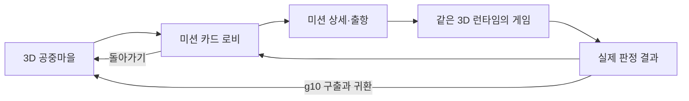

> 보관 설계: 최신 사용자 방향은 대표4종 v2입니다. 현재 제작은 [대표4종 제작기획서](../20261011_3D제작명세_v2_대표4종_Codex/00_제작기획서_Codex.md)를 따릅니다. 구 10종의 자산·문서는 삭제하지 않았습니다.

# 수스 아케이드 — 3D 본 게임 제작기획서 v1

작성: Codex · 2026-10-11  
대상: 사용자, 제작 AI, 기획·아트·프로그래밍 담당  
작업 프로젝트: `C:\soos-arcade`  
문서 단계: 컨셉·기본 구조·상세 규칙·초기 데이터·제작 순서의 설계 완료. 신규 게임 런타임 구현 전.

## 1. 만들 게임

정화숲의 복셀 세계에서 루온 또는 리아가 공중마을을 출발해 오염된 지역을 정화하고 반려동물을 데려오는 3D 액션 아케이드다. 이동 중심의 간단한 조작을 유지하면서 미션마다 생존, 방 돌파, 무리 지휘, 호위, 건설 방어, 굴착, 타워 디펜스, 보스전, 정화 칠하기, 탈출의 행동이 달라진다.

공중마을은 실제 주민과 동물이 살아가는 장소다. 바다 위 공중섬, 서로 다른 집 5채, 연결 다리, 비행선 선착장, 정화숲 수목과 생활 소품을 유지한다. 따뜻한 크림·주황, 녹색·민트 계열이 주민과 정화 상태의 색이며 오염은 탁한 보라로 읽힌다. 얼굴·동물·무기와 배경은 실제 수스 3D 자산을 사용한다.

**기획툴 안에서 실행하는 화면 자체가 본 게임 수준의 3D 플레이여야 한다.** 로비, 미션 카드 화면, 게임 각각을 따로 시험하고, 같은 런타임으로 연결 플레이도 한다. 이후 최종 게임에 붙일 때는 실행 셸과 저장 서비스만 교체한다. 별도의 간략 시뮬레이션 규칙을 본 게임과 병행해 만들지 않는다.

### 사용자 확정 범위

- 공통 구조 5종을 기반으로 게임 10종 전체 설계.
- 로비 공중마을, 카드 미션 로비, 게임 10종, 결과와 구출·귀환까지 포함.
- 수스의 기존 3D 소스와 리소스를 최대한 활용. 빠진 동작·상호작용·충돌·게임 데이터는 제작.
- 기획툴에서 조절 → 실제 플레이 → 결과 검토 → 설정 저장 → 재실행이 가능해야 함.
- 이번 문서 작업은 다른 AI에게 제작을 맡기기 위한 준비. 기존 기획툴·모델·게임 코드는 수정하지 않음.

## 2. 기획의 우선순위와 기준

1. 최신 사용자 지시가 제작 범위를 결정한다.
2. 기존 내용의 정본은 `planner/data.json`이다. 이 패키지는 정본을 조사해 작성한 **후속 제작 명세와 제안 초기값**이다. 정본 자체를 자동으로 덮어쓰지 않았다.
3. 아래의 충돌 정리와 새 초기값을 제작 AI가 변경 목록으로 등록한 뒤 구현한다. 이후 내용 변경은 기획툴의 구조화된 설정에 반영하고 문서를 재생성한다.
4. `docs/기획서.md`, 루트 README의 과거 6장·리소스 미복사 설명, 이전 시뮬레이션 수치는 현재 구현 기준으로 사용하지 않는다.
5. 제안 수치는 검증을 시작하기 위한 값이다. 실제 플레이의 난이도가 검증되었다는 뜻은 아니다.

### 기존 불일치의 제작 기준

| 항목 | 이번 제작 기준 | 적용 방법 |
|---|---|---|
| 게임 5종인지 10종인지 | 구조 5종, 게임 10종 모두 | g01~g10 유지 |
| 6장·9방·20방 혼재 | 한 바퀴 10미션, g02는 20방, 10·20방 보스 | 이전 숫자와 UI n/9 제거 |
| g07 8·10웨이브 혼재 | 8웨이브 | 후반 비행 적은 6~8웨이브에 편성 |
| 현재 미션 순서 | 정본 배열 s02→s03→s01을 보존해 초기 캠페인에 사용 | 상륙은 첫 외출 도입부, g01은 신호탑을 켠 뒤 해변에서 밀려오는 떼 방어로 대사 보정 |
| 첫 바퀴 펫 없음 | 인간만으로 모든 미션 클리어 가능 | g03 무리·g07 막사 동물은 현지 조력자. 이름 있는 구출 펫과 별개 |
| 별 의미 | 클리어 성적 1~3별 | 난이도 A/B/S 표시는 별과 별도로 표시 |
| g09 70% 도달 문제 | 목표 70% 유지, 시작 폭·칠하기·번짐 수치를 함께 조정 | 도달 가능성 계산과 실제 플레이 둘 다 검수 |
| g10 숲길 약 250m·90초·7~9m/s | 약 720m의 별도 미션 경로, 평균 약 90초 | 실제 숲의 굴곡 경로+재사용 길 모듈을 구성. 직선 거리와 경로 길이 분리 |
| g05 준비·밤 | 사용자가 전투 버튼으로 시작하는 준비/전투 | 시간대 변화는 환경 연출. 전투를 자동 시작시키지 않음 |
| 뒤 바퀴마다 방·층·단계 증가 | v1은 방 20·층 5·웨이브 8·보스 3단계 고정 | 적 편성·속도·패턴 변형으로 5바퀴 조절. 수량 증가안은 후속 데이터 확장 |
| 기존 HUD 스킬 6칸 | 바주카 3슬롯+패시브 4종, 속사는 기본무기로 별도 표시 | 작은 화면에서는 패시브를 두 번째 줄/접힌 요약으로 배치 |

미션 순서 변경 기능은 기획툴에 둔다. 순서를 바꾸면 이전 미션을 전제하는 대사·수레 발견·문 개방 이벤트를 함께 검사한다. 배열을 바꾸는 것만으로 이야기가 자동으로 맞는다고 처리하지 않는다.

## 3. 전체 흐름과 진행 구조

한 바퀴 = 오염 지역 하나의 미션 10개. 5바퀴 = 50미션 실행, 펫 5마리 구출. 미션별 저장이 되므로 한 바퀴를 한 번에 끝낼 필요가 없다. 첫 바퀴 클리어 시간은 약 35~42분을 목표로 삼되, 재도전·준비 선택·메뉴 시간은 별도다. 끝난 미션은 독립 재플레이 가능하다.

| 바퀴 | 구출 펫 | 동행 가능 조건 | 세계 연출 제안 |
|---|---|---|---|
| 1 | 뭉치 / NoFilter | 처음에는 동행 펫 없음 | 물든 해안과 숲의 첫 정화 |
| 2 | 해커캣 / block_cat | 이전 구출 펫 중 1마리 | 폐허 기계와 신호 복구 |
| 3 | Flux | 동일 | 바람길과 방어 시설의 복구 |
| 4 | Lumos | 동일 | 깊은 오염과 빛의 회복 |
| 5 | Gizmo | 동일 | 최종 지역 정화와 모두의 귀환 |

지역 이름과 오염물질 명칭은 임시다. 데이터 ID와 기능은 이름 확정에 의존하지 않는다. 신규 이름으로 현재 모델의 종·색·장비 디자인을 바꾸지 않는다.

영구 저장: 미션 개방, 최고 성적, 펫 구출, 선택 캐릭터·비율·동행 펫, 로비 설정. 판 안 성장: 무기·패시브·건물·조력자·굴착 가방. 판 안 성장은 다음 미션에서 초기화한다. v1에는 별을 소비하는 영구 전투 강화, 결제, PvP, 온라인 협동을 추가하지 않는다. 독립 플레이의 균형을 먼저 검증한다.

## 4. 공통 구조 5종

| 구조 | 게임 | 공유할 모듈 | 차이를 만드는 핵심 |
|---|---|---|---|
| A 전투·생존 | g01,g02,g04,g08,g09 | 배우, 자동조준, 무기, 투사체, 피해, 카드, 적, 예고 | 생존 시간 / 정지 사격 / 수레 경합 / 보스 패턴 / 지면 정화 |
| B 건설·방어 | g05,g07 | A의 전투, 건설칸, 시설, 비용, 웨이브, 경로 | 등대 중심 자유 압박 / 고정 길과 누출 방어 |
| C 무리·지휘 | g03 | A의 배우·피해, 내비, 조력자, 작업 배정 | 던지기·소집·속성 장애물·공동 운반 |
| D 지형·굴착 | g06 | 배우·전투, 블록 셀, 청크, 낙하, 내비 갱신 | 파괴·설치·깊이 이동·오염액 |
| E 추격·러너 | g10 | 배우·펫·풀링·카메라·결과, 스플라인 | 자동 전진·좌우·점프·추격·체크포인트 |

구조는 플레이 가능한 게임의 수가 아니다. 같은 구조의 게임도 독립 규칙·목표·맵·설정·튜토리얼·결과 검수를 가진다. 큰 if문 안에서 화면만 바꾸는 방식으로 10게임을 만들지 않는다.

## 5. 문서·데이터 읽는 순서

| 순서 | 파일 | 용도 |
|---|---|---|
| 1 | 이 문서 | 컨셉, 전체 구조, 확정 범위와 기준 |
| 2 | [공통 런타임·로비·기획툴](01_공통런타임_로비_기획툴_Codex.md) | 조작, 전투, UX, 연결·저장·조절 구조 |
| 3 | [게임 10종 상세](02_게임10종_상세제작명세_Codex.md) | 미션별 상태, 편성, 숫자, 승패·장애 예외 |
| 4 | [리소스 활용·아트](03_리소스활용_맵_아트_Codex.md) | 실제 원본, 재사용 범위, 추가 작업과 성능 |
| 5 | [초기 구조·데이터 계약](04_초기구조_데이터계약_Codex.md) | 제안 파일 구조, 인터페이스, 실행 데이터 |
| 6 | [제작 순서·검수](05_제작순서_검수_벤치마크_Codex.md) | 단계별 산출물, 플레이·성능 기준 |
| 7 | [제작 AI 프롬프트](06_제작AI_인수인계프롬프트_Codex.md) | 바로 전달할 착수 지시 |
| 부록 | [실제 리소스·적 설정 목록](07_실제리소스_적설정목록_Codex.md) | 실제 파일·클립·49종 역할 표 |
| 부록 | [역할 AI·서비스 계약](08_역할AI_상태_서비스계약_Codex.md) | 적 알고리즘·시설 타격 상태·M0 서비스 |
| 데이터 | `data/*.json` | 초기 조정값, 49종 적, 웨이브, 리소스 목록 |

## 6. 완료의 의미

문서와 모델이 있는 것, 뷰어가 열리는 것, 시뮬레이터가 자동 성공하는 것은 각각 별도 진척이다. **플레이 완성**은 실제 입력으로 목표를 수행하고 정상 승리·실패·재도전·저장·귀환이 되며, 같은 설정을 다른 화면에서도 재현할 수 있는 상태다.

제작 AI의 첫 산출물은 초기 런타임 구성과 로비→카드→g05→결과의 작은 실제 플레이 연결이다. 이후 같은 구조를 확장해 10종을 완성한다. 아직 없는 화면·기능은 제작 목록에서 미완료로 표시하고 버튼 하나로 성공 처리하지 않는다.
