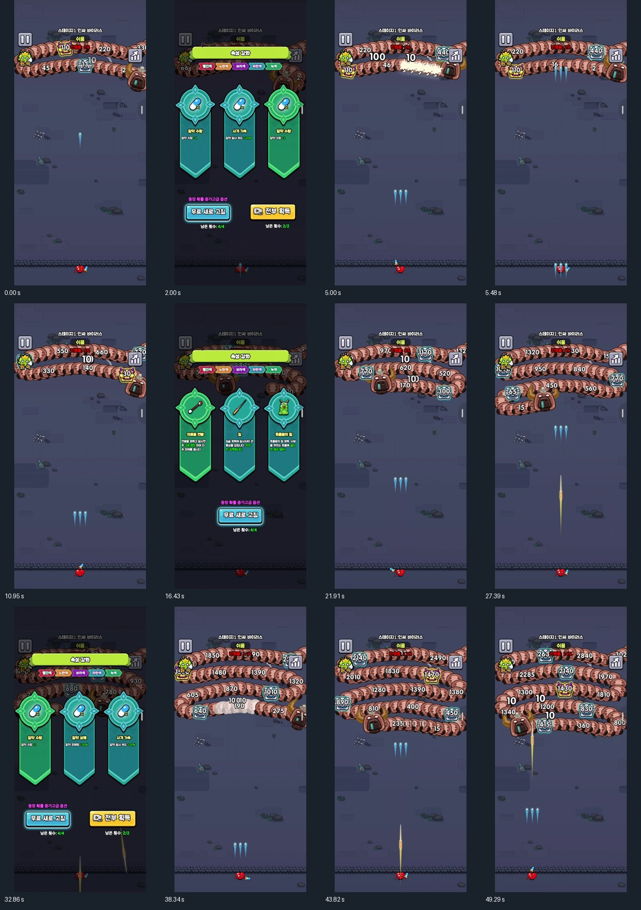
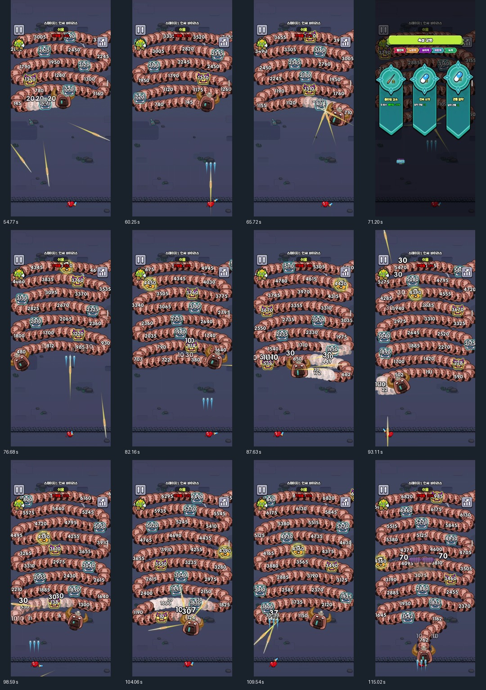
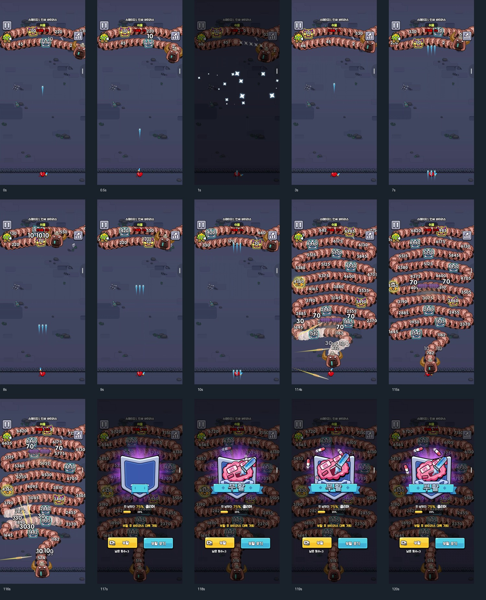

# Cell Survivor 사용자 영상 분석과 수스 적용

작성: Codex · 2026-10-11  
분석 자료: `C:\Users\dmaxd\Downloads\38833FF26BA1D.UnigramPreview_g9c9v27vpyspw!App\Screen_Recording_20261011_085021_Cell Survivor.mp4`

## 1. 확인 범위

영상은 1080×2340, 125.9726초, 7,837프레임, 파일 크기 208,638,488바이트다. 평균 메타데이터 프레임률은 약 62.21fps이며 플레이 성능 측정값이 아니다. 영상 시작부터 이미 적 대열이 있어 타이틀·초기 입장·첫 강화 이전은 담기지 않았다.

전 구간을 균등 샘플링한 25장과 초반/실패 전후 15장을 확인했다. 주요 화면의 원본 해상도도 확대해 카드 설명을 읽었다. 연속 프레임 전체를 재생했다는 뜻은 아니며, 정확한 피격 틱·수식·손가락 입력은 이 자료만으로 확정하지 않는다. 추출 스크립트와 메타데이터를 evidence에 함께 보관했다.

화면에는 ‘스테이지1: 인싸 바이러스’, ‘쉬움’, 진행률이 보인다. [Google Play의 개발자 등록 페이지](https://play.google.com/store/apps/details?id=defense.roguelike.cell.shoot.survivor)는 Cell Survivor를 Snap Brain Games의 슈팅·디펜스·로그라이크 게임으로 소개한다. [App Store 개발자 설명](https://apps.apple.com/us/app/cell-survivor-shoot-defense/id6746465127)은 적 무리를 넘긴 뒤 능력 3개 중 선택하는 구조를 설명한다. 세부 대열 규칙은 소개문보다 첨부 영상 관찰을 기준으로 한다.

## 2. 실제로 보이는 플레이

| 영상 시각 | 관찰 | 설계에 쓸 요소 |
|---|---|---|
| 0~0.5초 | 하단의 작은 배우가 상향 탄을 발사. 상단에 숫자 체력을 가진 긴 마디 대열과 큰 머리가 있음 | 하단 사격선과 개별 마디 표적 |
| 1~3초 | ‘속성 강화’ 3택 화면. 알약 수량 +2 / 발사 속도 +20% / 수량 +1 | 투사체 수·공속을 별도 강화 축으로 제공 |
| 5~11초 | 청색 탄이 3개 병렬로 올라감. 배우 위치가 좌우로 바뀌지만 하단 높이는 거의 고정 | 좌우 이동과 자동 전방 사격 |
| 약 16.43초 | 의료용 면봉 / 침 / 콧물용의 힘 신규 선택. 설명에 회전 지속 피해·관통·낙하류 효과 | 무기 모양과 발사 방식 분리 |
| 약 27~33초 | 청색 병렬탄에 긴 황색 투사체가 추가. 다시 수량·피해·공속 선택 등장 | 다중 무기와 같은 무기 강화의 병행 |
| 38~66초 | 대열이 여러 수평 줄을 차지하고 방향을 바꾸며 아래쪽으로 압박. 일반 마디·푸른 상자·황금 상자 각각 숫자 표시 | 경로 호길이·개별 HP·다른 표적 역할 |
| 약 71.20초 | 침 쿨타임 -25% / 알약 연발 +1 / 관통 +1 카드 | 공속·연발·동시 탄수·관통을 서로 다른 값으로 처리 |
| 82~110초 | 화면의 적 밀도와 숫자가 크게 올라감. 피격 숫자와 긴/회전형 공격이 겹침 | 후반 HP 예산과 실효 명중 화력의 균형 |
| 114~116초 | 큰 머리와 마디가 하단 경계까지 내려옴. 배우가 계속 사격 | 접근 위협의 가독성·도달 예상시간 |
| 117~126초 | 진행률 25%, 남은 75% 문구와 부활/부활 포기 화면. 클리어 장면 없음 | 실패·재도전 흐름. 원작 전체 판 길이는 미확인 |

## 3. 영상에서 확정할 수 없는 것

- 손가락이 보이지 않아 이동 입력이 드래그인지 조이스틱인지 확정 불가. 좌우 이동 결과는 관찰됨.
- 강화가 정확히 어떤 이벤트/경험치 수식으로 열리는지, 상자 파괴가 직접 원인인지 미확정.
- 대열이 한 생명체인지 여러 연결 적인지, 중간 마디가 죽을 때 새 머리가 생기는지 미확정. ‘대열을 자르는’ 수스 규칙은 새 설계다.
- 황색 탄의 비스듬한 경로가 반사·조준·다른 발사 위치 중 어느 규칙인지 미확정. 카드의 관통 설명만 확인됨.
- 하단 접촉 직후 실패하지만 ‘머리의 경계 통과’와 ‘플레이어 접촉 사망’ 중 정확한 조건은 미확정.
- 수천 단위 HP가 원작의 영구 강화와 어떻게 맞물리는지 미확정. 해당 숫자를 수스 HP8 기본무기에 그대로 복사하지 않음.
- 25% 실패 시각으로 전체 클리어 시간이 8분이라고 단정하지 않음. 선택 창 시간과 진행률 계산도 미확인.

## 4. 핵심 재미와 적용 원칙

이 유형은 자유 이동 추격전보다 **사격 열을 고르는 판단**이 중심이다. 머리·낮은 HP 마디·보상 표적 중 무엇을 우선 쏠지, 수량/관통/연발/범위를 어떤 순서로 키울지가 압박을 해소한다. 대열이 내려오는 동안 화력이 커지는 모습이 분명해야 한다.

수스 p04는 하단 정화 관문에서 루온/리아와 동행 펫이 오염 대열을 막는다. 기존 복셀 몬스터를 마디/머리/호위로 재구성하고, 알약·바이러스의 그림은 가져오지 않는다. 청색 탄은 기존 쌍권총, 황색 관통은 번개 직사탄, 회전·낙하 공격은 기존 얼음/폭탄 FX와 발사 방식으로 대응한다.

경계 실패·마디 제거 후 경로·성장 지급·HP 예산을 [02의 p04](02_대표4종_상세제작명세_Codex.md)에 명시했다. 이는 원작 내부 규칙을 알아냈다는 주장이 아니라 영상의 조작·압박·선택 리듬을 수스에서 구현하는 초기 명세다.

## 5. 증거 화면

대표 원본 프레임: [2초 강화](evidence/frame_0002.00.jpg), [16.43초 신규 무기](evidence/frame_0016.43.jpg), [71.20초 연발·관통](evidence/frame_0071.20.jpg), [115.02초 하단 위협](evidence/frame_0115.02.jpg), [120.50초 부활 창](evidence/frame_0120.50.jpg).

원본 영상은 이동/수정하지 않았다. 전달 ZIP에는 분석 프레임·스크립트·메타데이터만 포함하며 대용량 영상은 위 로컬 경로에서 읽는다.
