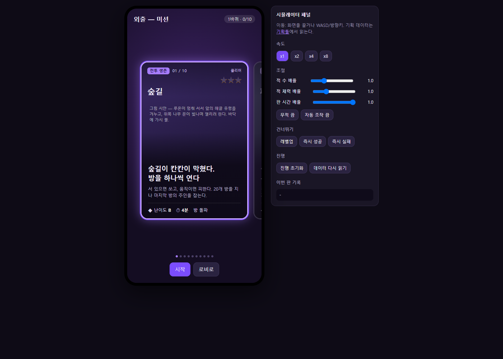
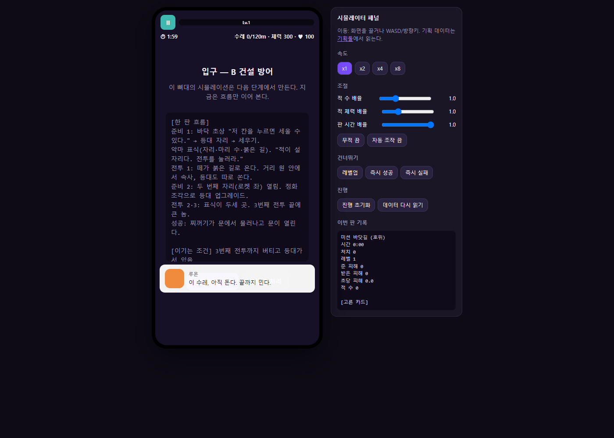

# 작업 검토 의견서 — 수스 아케이드 기획과 게임별 검증 구조

작성: **Codex** · 2026-10-10  
프로젝트: `C:\soos-arcade`  
범위: 현재 기획·소스·실행 상태 검토. 게임 구현과 기획 변경은 하지 않았다.

## 1. 한 줄

**수스 아케이드는 정화숲 세계관과 기존 사람·반려동물·복셀 리소스를 활용해 여러 액션 게임을 미션으로 연결하는 별도 프로젝트다. 각 게임을 독립적으로 실제 플레이하고 검증한 뒤 전체 이야기 흐름에 연결하는 개발 구조를 권한다.**

## 2. 어떤 프로젝트인가

현재 정본은 `planner/data.json`이다. `docs/기획서.md`는 그 데이터를 내보낸 문서다. 초기 6장 시나리오 등 날짜가 같은 옛 문서는 참고 이력으로 구분해서 읽었다.

- 기존 수스 `C:\xoox`와 분리한 새 게임이다. 루온·리아, 정화 동물, 쌍권총·바주카, 정화숲·복셀 리소스를 재사용한다.
- 사람이 버린 통의 찌꺼기로 오염된 지역을 정화하고 잃어버린 동물을 구한다.
- 현재 기획은 게임 타입 10종, 공통 제작 뼈대 5종이다. **게임 타입과 미션은 다른 단위**다. 미션은 게임 타입 + 맵 + 목표/설정의 조합이며 같은 타입을 다른 장소에 다시 사용할 수 있다.
- 한 바퀴의 미션을 마치면 동물 1마리를 구하고, 5바퀴·5지역·5마리로 이어지는 초안이다.
- 로비 → 외출 → 미션 카드 → 게임 → 결과 → 미션 카드 → 구출 → 로비가 전체 흐름이다.
- 모바일 세로 화면, 원판 이동을 기본으로 한다. 조작과 무기 사용은 게임별 예외가 있다. 화면 방향은 기획의 열린 질문에도 남아 있다.
- 공중마을 VILLAGE03은 로비 자산으로 등록되었다. 주민 생활·24시간 하늘·바다·비행선 등은 미리보기에서 확인한 별도 기능이며 실제 외출/출항 메뉴 연결은 후속 작업이다.

## 3. 현재 진행 상태

### 3.1 기획과 실제 실행 구분

| 구분 | 확인한 상태 |
|---|---|
| 기획툴 | 게임 타입 10종, 미션·맵 설정, 리소스, 참고작, 결정·질문을 관리한다. |
| 현재 시뮬레이터 | `planner/sim.html`. Canvas 2D로 조작과 일부 규칙을 구현했다. |
| 실제로 조작 가능한 타입 | g01 떼 버티기, g02 방 돌파, g04 호위, g08 보스, g09 칠하기: 5종. |
| 흐름 설명과 처리 버튼만 있는 타입 | g03 무리 지휘, g05 짓고 버티기, g06 블록 파기, g07 길목 방어, g10 탈출: 5종. |
| 3D 준비 자료 | 캐릭터·펫·복셀 유닛, 정화숲, 전투 스킬·기존 방어 세션, 유닛/전투/숲 도구를 가져왔다. |
| 미션 맵 | 검토 중 Claude가 1차 제작을 완료했다. m01 상륙 섬, m02 숲길 방 6종, m04 구름다리길과 수레·등대·신호탑: 정화/오염 GLB 22개, 약 71.9 MiB와 배치 JSON·Blender 원본이 실제로 존재하고 정본에 등록되었다. 나머지 맵 7개는 `설정 중`, 파일 연결은 비어 있다. 새 게임의 조작·충돌·승패 연결은 별도 단계다. |
| 새 아케이드의 독립 3D 실행 | 검토한 Vite 진입점과 시뮬레이터에서 10종에 연결된 새 3D 게임 실행 화면은 확인하지 못했다. 기존 3D 도구를 재사용할 기반은 있다. |

`확정`은 현재 게임 기획의 상태다. 구현·실행·검증 완료 상태로 읽으면 진행률을 잘못 판단하게 된다.

### 3.2 시뮬레이터가 게임처럼 보이는 이유

로비, 미션 잠금, 카드 선택, 결과의 별, 구출, 다음 바퀴, 진행 저장이 이미 들어 있다. 그래서 전체 게임의 인상이 강하다. 그러나 개발자가 게임 10종 중 하나를 바로 골라 시작하는 기본 동선이 없고, 앞 미션 완료 여부가 테스트 접근에도 영향을 준다.

현재 시뮬레이터가 읽는 기획 데이터와 실제 실행 수치는 완전히 연결되어 있지 않다. 게임 설명·미션 정보는 정본에서 읽지만, `SKILLS`, 적 설정, 시간·공격·스폰 규칙은 HTML 안에 따로 구현되어 있다. 기존 3D 전투 툴은 별도의 `assets/susu/tools/combat_skill/skills.json`과 전투 코드를 사용한다. 2D 실험의 수치 결과를 그대로 최종 3D 게임의 결과로 간주할 수 없다.

## 4. 직접 확인한 개선점

| 항목 | 근거와 영향 | 권장 보정 |
|---|---|---|
| 방 개수 | g02 흐름·수치는 20방/10·20 보스인데 UI·제작 항목에는 9방/9번 보스가 남아 있다. 회복/카드 시점도 서로 다르다. | 방 개수, 보스 방, 회복 방을 하나의 설정으로 정하고 HUD·스폰·승리에 같이 사용한다. |
| 웨이브 수 | g07 승리 조건은 8웨이브, 흐름은 8~10, UI는 n/10, 반복 설명에는 더 많은 웨이브가 적혀 있다. | 최초 검증 시나리오의 총 웨이브를 고정하고 확장 바퀴 설정은 별도로 둔다. |
| 이동 중 사격 | g02는 멈췄을 때 사격하는 타입이다. 실행 검사에서 이동 중 권총 0발, 불 로켓 1발이 생성되었다. | 사격 제한을 각 무기 발사 직전에 공통 적용하고 타입의 예외를 명시한다. |
| 칠하기 범위 | 정본의 초기 수치는 지름 2m, 실행은 반경 1.5m다. 코드에서도 변경 사유를 별도 주석으로 관리한다. | 반경/지름·단위를 구분한 실행 설정 하나를 쓰고 목표 비율과 같이 기록한다. |
| 칠하기 가능 여부 | 질문 q11은 시뮬 최대 53%를 근거로 70% 불가능이라고 적었다. 특정 자동 조작 결과만으로 사람 플레이 전체의 불가능을 판단할 수 없다. | 지도·속도·칠 범위·샘 재오염·자동 조작 경로·시드를 기록한 사례로 취급하고 사람 플레이와 비교한다. |
| 흐름 처리와 검증 성적 | 미구현 g05에서 ‘성공으로 처리’를 누르니 클리어 저장과 별 3개가 기록되었다. 플레이어가 없어서 체력 비율 기본값 1이 적용된다. | 흐름 확인의 강제 성공은 개발 기록에만 표시하고 실제 검증 완료·성적과 분리한다. |
| 흐름 화면의 HUD | 같은 페이지에서 g04 다음 g05를 열면 g05 흐름 화면에 앞 호위의 수레 HUD·기록이 남았다. | 새 게임 시작 때 HUD·기록·오브젝트를 초기화하고 타입이 지원하는 지표만 표시한다. |
| 미션 순서와 도착 이야기 | 현재 배열은 숲길 → 폐허 → 해변 상륙이다. 해변은 배에서 내리자마자 시작하는 이야기로 적혀 있다. | 의도한 플레이 순서를 확인하고 순서 필드를 명시한다. 타입 ID/화면 순서/이야기 순서를 구분한다. |
| 귀환 성공 | g10 승리에는 동물 빛을 안고 있어야 한다고 적었지만 다른 설명에는 동물 없이 성공 가능한 문장이 남아 있다. | 탈출 성공과 구출 완료를 따로 둘지, 둘 다 필수인지 한 가지 규칙으로 정한다. |
| 성장과 바퀴 | 현재 2D 실행은 미션 시작마다 레벨·무기를 초기화한다. 보스전은 무기 3개를 임의 부여한다. 바퀴 번호는 저장되지만 지역·게임 난도 변화로 이어지는 공통 규칙은 아직 없다. | 미션 안 성장 / 다음 미션에 남는 성장 / 로비에 남는 보상을 구분한다. |
| 5마리 이후 | 시뮬레이터는 5마리 구출 뒤에도 다음 바퀴로 갈 수 있고 구출 목록의 첫 동물을 다시 선택하는 대체 처리가 있다. | 5지역 종료, 다시 플레이, 추가 콘텐츠 중 어떤 흐름인지 정한다. |
| 장소 설정 | 새 m04는 해안 도로에서 공중섬의 구름다리길로 변경되었다. 나머지 미션과 적 진입·귀환의 세계 연결도 맞춰야 한다. | 공중마을·공중섬·지하·정화숲 사이의 연결, 추락/이동 경계를 맵과 규칙에 함께 정의한다. |
| 별 평가 | 현재 남은 체력의 공통 임계값을 쓴다. 칠하기·호위·러너의 목적 달성 정도는 반영되지 않는다. | 타입별 평가 기준을 두고 기준을 확정하기 전에는 임시 성적임을 표시한다. |

게임별 진화 무기, 카드 선택, 방 장애물·시야/충돌, 동물별 능력도 현재 2D 구현에서는 단순화되어 있다. 검증 대상 규칙을 명시해야 ‘화면에 있으니 완성’으로 오해하지 않는다.

## 5. 권장 개발 구조

### 5.1 네 가지 역할

| 화면 | 용도 |
|---|---|
| 기획툴 | 타입·맵·미션·목표·리소스를 편집하고 결정 사항을 기록한다. |
| 게임별 실행 | 10종을 각각 바로 선택한다. 미션 잠금 없이 맵·사람·펫·난도·시간 설정 후 시작/일시정지/재시작한다. |
| 플레이 검증 패널 | 같은 게임 실행 옆에서 적 수, 피해/처치, 목표 진행, 프레임 시간, 자동 조작·무적·배속 등을 본다. |
| 전체 흐름 보기 | 로비·카드·구출·저장·다음 바퀴의 연결과 대사를 검토한다. 미구현 장면은 흐름 확인 상태로 표시한다. |

**검증 툴과 최종 게임은 같은 실행 코드와 설정을 사용해야 한다.** 최종 게임으로 넘어갈 때 개발 패널을 숨기고 메뉴를 연결한다. 조작·충돌·목표 판정을 새로 만드는 전환은 피한다.

현재 2D 화면은 전체 흐름과 초기 수치 비교 자료로 보존할 수 있다. 실제 게임에 가까운 신규 검증은 기존 3D 캐릭터·복셀 유닛·1차 제작된 맵을 연결해서 진행한다.

### 5.2 공유할 것과 타입별 규칙

공유 기반은 입력, 캐릭터/펫 표시와 애니메이션, 투사체·피격·상태 효과, 적 생성, 시간, 저장할 결과다. 각 타입은 목표와 승패, 이동/사격 제약, 필요한 행동을 정의한다.

- g02: 정지 사격, 방 종료, 문 열기.
- g04: 수레 이동·정지, 호위 거리, 수레 체력.
- g05/g07: 건설·표적·준비/웨이브·본진 체력.
- g06: 파괴/설치와 낙하·침수.
- g09: 칠한 면적·샘 봉인·재오염.
- g10: 전진·좌우·점프·구출물 운반.

공통 기반을 쓰더라도 모든 게임에 똑같은 자동 사격·카드 규칙을 강제로 적용하지 않는다. 정본의 공통 설명은 타입별 적용 여부 표가 필요하다.

### 5.3 설정과 진행률

1. 설명 문장과 별도로 숫자·단위·목표를 구조화한 실행 설정을 둔다. 예: `durationSec`, `roomCount`, `waveCount`, `paintRadiusM`, `winConditions`.
2. 캐릭터·펫·복셀 적은 리소스 ID로 연결하고 직접 사용하는 모델, 복셀 변환 원본, 참고 자료를 구분한다.
3. `기획 확정 / 제작 중 / 단독 실행 가능 / 플레이 검증 완료 / 전체 흐름 연결` 상태를 따로 표시한다.
4. 검증 결과에는 설정 버전, 맵, 캐릭터·펫, 시드, 일반/무적/자동/배속 여부를 남긴다. 동일 조건을 다시 실행할 수 있게 한다.
5. 단독 테스트 진행은 본 게임의 구출·별·미션 잠금 저장과 분리한다.
6. 게임 시작/종료 시 소유한 객체와 이벤트를 정리하여 이전 게임의 HUD·적·입력·타이머가 다음 게임에 남지 않게 한다.

## 6. 기존 리소스와 소스 재사용 판단

| 위치 | 활용할 수 있는 부분 | 연결 시 검토할 것 |
|---|---|---|
| `src/tools/forestPlay/PlayCharacter.ts` | 실제 모델·캐릭터 카탈로그·애니메이션 로딩/재생 | 입력과 애니메이션 상태를 새 게임 타입에 연결한다. |
| `src/tools/forestPlay/PlayCombat.ts` | 기존 3D 투사체·자동 공격·적 이동의 구현 자료 | 새 타입의 사격 제약, 피해 설정, 충돌 규칙에 맞춘다. |
| `src/tools/forestPlay/DefenseSession.ts` | 방어 시설·웨이브·본진 진행의 구현 자료 | 기존 900/940초 세션을 새 g05/g07의 4~5분 설정과 혼동하지 않는다. |
| `src/tools/combatSkill/main.ts`, `assets/susu/tools/combat_skill/skills.json` | 무기·발사·폭발 표현과 설정 | 2D `SKILLS`와 중복된 값을 통합할 범위를 정한다. |
| `src/tools/unitLabTool/` | 복셀 유닛·모델 비교·캐릭터/펫 동작 검수 | 실제 게임의 적 수에 맞는 블록 해상도·LOD·그림자 비용을 측정한다. |
| `assets/village/releases/VILLAGE03/` | 로비 환경과 배치 자산 | 바닷가 전투 맵과 공중마을 로비를 별도 장소로 관리한다. |

이는 재사용 후보 판단이다. 새 아케이드 규칙과의 호환성이나 모바일 성능을 이번 짧은 검토에서 검증 완료한 것은 아니다.

## 7. 만드는 순서와 한 게임의 완료 기준

### 권장 순서

- **첫 단계: g01 떼 버티기.** 넓은 맵 하나, 사람 하나, 대표 복셀 적 2~3종, 권총/바주카, 실제 승패·재시작을 연결한다. 공통 전투 기반을 가장 단순하게 검증할 수 있다.
- **다음: g02 방 돌파.** 1차 제작된 방 모듈과 연결하고 정지 사격·문/방 전환을 검증한다.
- **공통 전투 확장: g08 보스, g04 호위, g09 칠하기.** 보스 패턴·보호 대상·면적 목표를 각각 독립적으로 검증한다.
- **방어 기반: g05 짓고 버티기 → g07 길목 방어.** 기존 방어 소스를 활용하되 새로운 시나리오와 시설 역할을 설정한다.
- **별도 행동 기반: g10 러너, g03 무리 지휘, g06 블록 파기.** 각 타입의 조작·지형/길찾기 요구를 별도 실험으로 만든다.

이 순서는 제작 효율을 위한 제안이다. 플레이어가 경험할 미션 순서를 바꾸는 결정은 아니다. 게임 10종은 유지한다. 기획 질문 q9의 기존 추천(05 우선)도 가능한 선택이며, 방어를 먼저 보고 싶은 경우에는 그 흐름을 선택할 수 있다.

### 하나씩 직접 해볼 수 있는 완료 기준

- 목록에서 해당 게임을 즉시 실행할 수 있다.
- 실제 모델·맵에서 조작·충돌·애니메이션·목표 진행을 확인할 수 있다.
- 강제 처리 버튼 없이 실제 성공·실패가 발생한다.
- 일시정지·재시작·종료를 반복해도 이전 실행이 남지 않는다.
- 규칙별 주요 지표와 설정 버전을 기록한다.
- 세로 화면과 대표 모바일 성능을 확인한다. PC 미리보기만으로 모바일 성능 완료를 선언하지 않는다.

테스트용 짧은 시간 설정과 본 게임의 시간을 구분한다. 현재 시간 설명을 단순 합산하면 한 바퀴 약 38.5~39.5분(호위는 기본 2분 + 지점 3개 각 1분, 보스는 2~3분으로 계산)이며 실제 진행과 실패/재시작에 따라 달라진다. 5바퀴는 대략 3시간대의 분량이라서 ‘짧게 한 게임씩 즐기는 아케이드’의 이용 방식과 저장/중단 지점을 함께 검토할 필요가 있다. 이를 근거로 미션을 임의로 삭제하거나 시간을 변경하지는 않았다.

## 8. 실행 검사와 증거

검사 주소: `http://localhost:4174/planner/sim.html?screen=cards`.

분리된 Playwright 브라우저 환경에서 10종을 각각 초기화했다. 앞 미션 잠금을 우회한 호출은 검사를 위한 것이며 사용자 화면에 독립 실행 기능이 이미 있다는 뜻은 아니다. 실제 사용자의 진행 저장에는 접근하지 않았다.

- 10종 중 플레이어가 생성된 타입 5종, 흐름 대체 화면 5종을 확인했다.
- 방 돌파에서 오른쪽 키 250ms 입력 뒤 실제 좌표가 이동했다.
- 이동 중 권총 0발/로켓 1발을 확인했다.
- 미구현 짓고 버티기에서 강제 성공이 별 3개를 저장하는 것을 확인했다.
- 이 검사에서 브라우저 실행 오류는 없었다. 모든 타입의 끝까지 플레이, 난도·성능 검증은 이번 검사 범위가 아니다.

소스 근거: `planner/sim.html`의 진행 초기값(190), 결과/구출(262/279), 별도 무기 설정(302), 게임 분기·흐름 대체(323/335), 사격(393), 칠 범위(508), 방 돌파(584).

증거 파일:

- `assets/20261010_arcade_review/simulator_inspection.json`: 실제 실행 결과.
- `assets/20261010_arcade_review/inspect_simulator.cjs`: 검사 재현 스크립트.
- `assets/20261010_arcade_review/review_baseline.json`: 검토 시점 정본·소스 해시와 문서 목록.

추가 캡처: `simulator_g01_current.png`, `simulator_g02_current.png`, `simulator_g07_current.png`.

## 9. 읽은 자료와 우선순위

- 정본: `planner/data.json`의 전체 항목(개요, 시나리오, 게임 10종, 맵 10개, 카드, 리소스, 참고·결정·질문·검증 기록).
- 정본의 출력: `docs/기획서.md`.
- 제작 방향·초기 기획: `docs/20261010_기획작성계획.md`, `20261010_다른AI_아이디어프롬프트.md`, `20261010_로비까지_시나리오.md`, `20261010_리소스활용계획.md`, `20261010_외출카드_기본기획.md`, `20261010_이야기흐름.md`, `20261010_일행과로비_세부기획.md`, `20261010_카드01_푸더덕_기획.md`, `20261010_카드시나리오.md`.
- 로비 계획: `docs/plans/20261010_공중섬마을_제작계획_Codex.md`.
- 검토 중 추가 확인: `docs/작업완료보고서/2026-10-10_미션맵_1차.md`, 맵 3종의 최신 정본 등록과 `assets/maps/` 실제 산출물.
- 진행 이력: `docs/작업완료보고서/`의 기존 보고, `docs/status/BOARD.md`, 현재 등록·마을 보고.
- 구현: README, package/Vite 진입점, 기획 서버/화면, 시뮬레이터, 가져온 전투·유닛·방어 소스.

옛 문서의 6장, 펫을 처음부터 고르는 규칙, 예전 로비·리소스 복사 대기 기록은 정본의 최신 결정을 덮는 지시로 취급하지 않았다. 그룩봇 지시서·작업 목록은 확인하지 않았다.

## 10. 바꾼 파일 / 하지 않은 일 / 남은 결정

### 바꾼 파일

- 이 검토 의견서.
- `docs/reports/assets/20261010_arcade_review/`: 실행 검사 스크립트·결과·스크린샷·검토 기준 기록.
- `docs/status/BOARD.md`: Codex 자기 행.

### 하지 않은 일

게임 소스, 정본 기획 데이터, 생성 기획서, 리소스, Claude 작업 파일은 변경하지 않았다. 기존 수스·CodexPack도 변경하지 않았다. 커밋·푸시·새 게임 제작은 하지 않았다.

### 논의할 결정

1. 게임별 독립 3D 실행 + 같은 실행 코드의 검증 패널이라는 개발 구조.
2. 첫 구현 타입: 공통 전투를 먼저 확보하는 g01 또는 기존 q9의 g05.
3. 방·웨이브·귀환·성적·성장의 서로 다른 설명을 정리할 기준.
4. 가로 공중마을 미리보기와 세로 게임 화면의 최종 연결 방식.

검토 작업은 완료했다. 위 항목은 제작 착수 전에 논의할 설계 선택지이며, 이번 의견서에서 임의로 확정하지 않았다.
