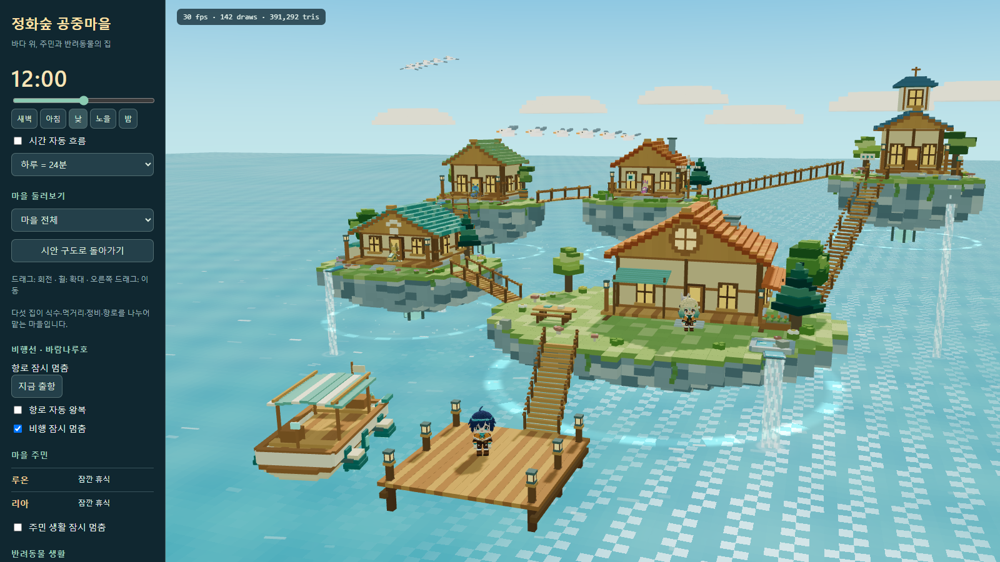
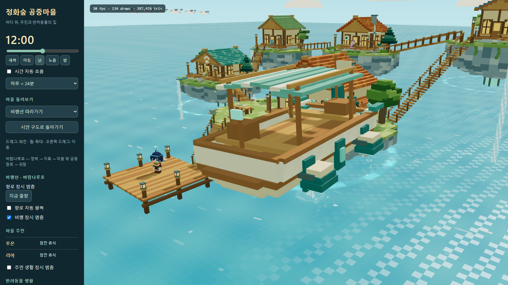
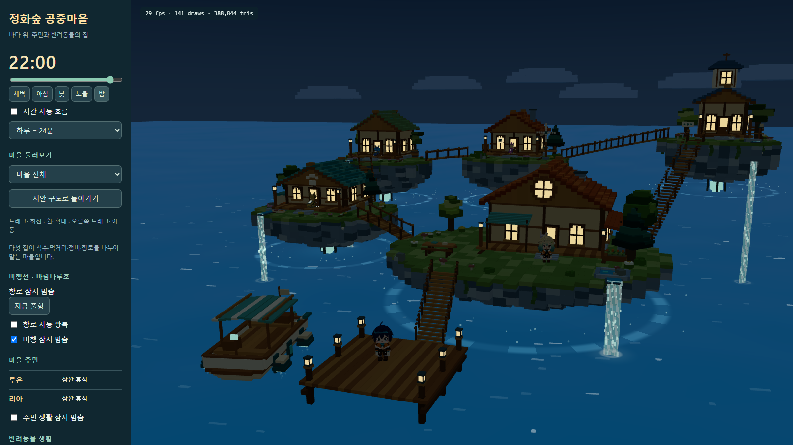
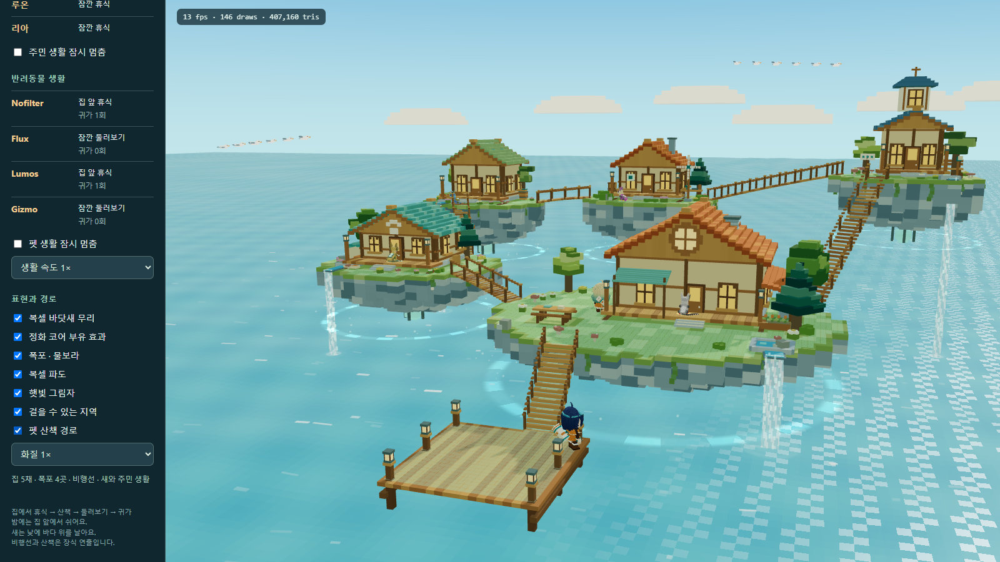

# 작업 보고서 — 공중마을 생활·부유·폭포·비행선·바닷새

작성: Codex · 2026-10-10  
대상: C:\Users\dmaxd\Downloads\xoox-master\xoox-master  
버전: VILLAGE03

## 한 줄

새 마을 툴에 가벼운 복셀 바다와 24시간 하늘, 보행 내비 메시, 집 앞 휴식과 산책을 하는 펫·주민, 공중섬의 부유 효과와 수원에서 이어지는 폭포, 왕복 비행선과 바닷새를 적용했다.

## 확인 위치

- 툴: http://127.0.0.1:5180/village-lobby-tool.html?revision=VILLAGE03-final
- Blender 전체: [village03_living_airship.blend](../../art-source/village/VILLAGE03/village03_living_airship.blend)
- Blender 새: [village03_sea_bird.blend](../../art-source/village/VILLAGE03/village03_sea_bird.blend)
- 상세 제작·실행·검증 방법: [README](../../art-source/village/README.md)
- 진행 계획: [공중섬 마을 계획](../plans/20261010_공중섬마을_제작계획_Codex.md)

## 바꾼 파일

| 분류 | 위치 | 내용 |
|---|---|---|
| Blender 제작 | art-source/village/bake_navigation02.py | 실제 보행면과 장애물에서 내비 메시 추출, 계단 착지 수리 |
| Blender 제작 | art-source/village/build_living03.py | 집별 생활 소품, 연못·물길, 코어·덩굴, 비행선 장치, 최종 보행 영역 |
| Blender 제작 | art-source/village/build_bird03.py | 몸통과 양 날개로 된 복셀 바닷새 |
| 편집 원본 | art-source/village/VILLAGE02/, VILLAGE03/ | 내비 장면, 생활·비행선 장면, 새 .blend |
| 배포 자산 | data/village/releases/VILLAGE02/, VILLAGE03/ | 환경·새·내비 GLB, 배치·생활 설정·보행 JSON |
| 툴 | village-lobby-tool.html, src/tools/villageLobby/main.ts | 전체 보기, 시간·지역·주민·비행선·생활·효과·경로 조작 |
| 시간·바다 | src/tools/villageLobby/DayNight.ts, VoxelOcean.ts | GPU 파도, 복셀 태양·구름, 달·별, 시간별 색과 빛 |
| 보행·생활 | src/tools/villageLobby/Navigation.ts, PetLife.ts, VillageResidents.ts | A*, 실제 이동, 휴식·귀가, 사람·펫 양보 |
| 연출·운송 | src/tools/villageLobby/IslandEffects.ts, Airship.ts, BirdFlock.ts | 부유·폭포, 정박/이륙/귀항, 새 무리와 날갯짓 |
| 실행 항목 | vite.config.ts | 독립 미리보기 툴 빌드 항목 |
| 검증 | art-source/village/verify_runtime02.cjs, verify_runtime03.cjs, review_living03.cjs, debug_traffic03.cjs | 시뮬레이션, 실제 브라우저, 성능과 화면, 교착 재현 |
| 기록 | docs/reports/assets/20261010_village02/, 20261010_village03/ | 낮·노을·밤·지역·비행선·보행 스크린샷 및 JSON 검증 |
| 문서 | art-source/village/README.md, 제작 계획, docs/status/BOARD.md | 재현 절차·현재 완료 범위·Codex 상태 |

새 프로젝트 node_modules에 빠져 있던 동일 버전의 Windows Rollup/esbuild 네이티브 패키지도 원본에서 복사해 Vite 실행을 복구했다. 새 라이브러리 다운로드는 하지 않았다.

## 핵심

### 바다와 시간

- 수면 메시 1개와 512개 인스턴스 포말: 2드로콜·16,512삼각형.
- 파형·복셀 높이·색과 반사는 GPU에서 계산한다. 매 프레임 CPU 정점 갱신이나 유체 계산을 하지 않는다.
- 0~24시 슬라이더, 새벽/아침/낮/노을/밤, 자동 하루 24분·8분·2분·실제 24시간.
- 복셀 구름 7개, 복셀 태양과 빛 테두리, 달·별, 낮밤 하늘·광량·창 조명.
- 태양/달은 실제 하늘 위치이므로 시각과 카메라에 따라 기본 구도 밖에 있을 수 있다.

### 섬과 생활 지역

- 섬 하단에 정화 코어, 둘레의 빛, 느리게 올라가는 복셀을 추가했다. 낮 화면에서 하단이 암석에 가려지는 문제를 보고 둘레의 효과를 넓혔다.
- 물이 시작되는 연못 → 돌 물길 → 절벽 밖의 폭포 → 바다 포말을 네 곳에 연결했다.
- 섬을 개별로 흔들지 않아 다리와 주민의 실제 보행 좌표를 유지한다.
- 집별로 우물·공동 식탁·허브, 작은 펫 집·물그릇·놀이 단차, 채소밭·빗물통, 작업대·화물·바람 장치, 벤치·망원경·항로 표지를 구분했다.
- Blender에서 새로 누적한 상자는 755개다. 상자마다 별도 오브젝트를 생성하지 않고 구조물별 메시로 묶었다.

### 내비 메시와 생활

- 실제 Blender 보행면을 .42m 격자, 발 반경 .30m, 최대 단차 .46m로 구웠다.
- 새 생활 소품·연못·물길의 영역을 제외하고 간선 통과도 검사했다.
- 최종 4,021노드·8,042삼각형·17구역. 모든 집 앞에서 다섯 섬·다리·계단·선착장까지 연결된다.
- 펫: 집 앞에서 앉아 휴식 → 일어나기 → 산책/짧은 달리기 → 둘러보기 → 귀가 → 앉기. 시간과 방문지는 개체별로 다르다.
- 주민: 기존 루온은 선착장, 리아는 메인 마당·현관에서 걷기/휴식/손인사를 한다. 새로운 인간 모델로 바꾼 것은 아니다.
- 사람·펫이 서로 가까우면 길을 양보하며 밤에는 새 출발을 줄이고 대기 위치로 돌아간다.
- 좁은 정원 입구에서 NoFilter와 Gizmo가 마주 보고 막히는 사례를 재현했다. 지나치게 넓었던 동적 금지 반경을 실제 간격에 맞추고, 간선 최근접 거리 검사·인접 구역으로 물러나기·검색 재시도 간격으로 해결했다.

### 비행선과 하늘의 새

- 나무 배의 선체를 유지하고 부유 장치 4개, 꼬리 날개와 프로펠러 2개를 Blender에서 추가했다.
- 바람나루호: 정박 24초 → Catmull-Rom 공중 항로 135초 → 귀항. 정박 부유, 선회, 프로펠러, 추진 입자, 수동 출항·정지·따라가기.
- 실제 한 항로 검증: 최대 높이 26.22m, 정박 복귀 오차 2.12cm(부유 동작 포함). 이동에 순간 점프 없음.
- Blender의 복셀 바닷새 모델을 합쳐 12마리를 두 무리로 배치했다. 1드로콜·2,448삼각형, GPU 날갯짓과 비행. 밤에는 비행 표시를 멈춘다.

## 검증 결과

### 생활 30분

최종 사람 2명과 펫 4마리가 함께 있는 조건이다.

| 대상 | 산책/귀가 | 확인 |
|---|---:|---|
| NoFilter | 귀가 13회 | 일어나기·걷기·둘러보기·앉기 |
| Flux | 귀가 13회 | 동네·이웃 섬 방문 |
| Lumos | 귀가 12회 | 사람·펫과 길 양보 |
| Gizmo | 귀가 14회 | 좁은 입구 교착 해소 |
| 루온 | 산책 57회·손인사 10회 | 선착장 안 이동·밤 원위치 |
| 리아 | 산책 48회·손인사 12회 | 마당/현관 이동·밤 원위치 |

- 보행 경로는 실제 그래프 간선으로만 구성되고 순간 이동 없음.
- 펫끼리 최소 거리 약 .744m, 주민과 펫 약 .838m.
- 밤에 펫이 새 산책을 시작하지 않음, 주민 귀가, 생활 정지 확인.
- 전체 툴의 TypeScript 검증 통과.
- 실제 Chrome/WebGL 로딩·GLSL·JavaScript 오류 0건.
- 결과: [simulation.json](assets/20261010_village03/simulation.json), [browser_validation.json](assets/20261010_village03/browser_validation.json).

### 성능

Intel UHD Graphics 620 / 로컬 Chrome headless / 캔버스 1335×900 / 픽셀 배율 1 / 같은 시간·카메라·그림자 캐시 조건에서 GPU 타이머 30샘플의 중앙값이다.

| 조건 | 드로콜 | 삼각형 | CPU 제출 | GPU |
|---|---:|---:|---:|---:|
| 부유·폭포·비행선 입자·새 모두 표시 | 142 | 391,292 | 3.80ms | 14.07ms |
| 위 새 동적 연출만 숨김 | 135 | 380,226 | 2.80ms | 13.41ms |

추가 동적 연출은 합계 7드로콜·11,066삼각형, 이번 GPU 비교에서 약 .66ms 증가했다. 정적 소품은 양쪽 모두 포함된 비교이므로 .66ms를 모든 신규 자산의 총비용으로 해석하지 않는다. 실제 일반 화면은 이 PC의 검수에서 약 30fps대였으며 모바일 또는 60fps 보장 측정은 아니다. 그림자는 1024 맵·초당 5회 갱신하고 나무 등 반복 소품을 인스턴싱했다.

## 하지 않은 일

- 원본 C:\xoox와 가져온 주민·숲 GLB, 기존 VILLAGE01/02를 변경하지 않았다.
- 실제 게임 메뉴, 승선·비행 조작, 실내 방과 실내 이동을 연결하지 않았다. 펫의 집 휴식은 집 앞 현관이다.
- 집의 창·문·지붕과 선착장 전체를 시안 수준의 최종 건축 상세로 완성한 것은 아니다. 이번은 사용자가 추가한 생활·공중·하늘 연출과 미리보기 범위다.
- 커밋·푸시, 그룩 루틴 확인, 복사본 CodexPack 작업은 하지 않았다.

## 막힌 질문

없음. 요청한 툴 연출·생활 동작과 검증·스크린샷·문서를 저장했다.

## 스크린샷

### 전체 마을과 바닷새

### 마을 앞 상공의 비행선

### 밤의 정화 코어와 폭포

### 주민·펫과 실제 보행 지역

추가 근접 화면: village03_main_details.png, village03_airship_dock.png, village03_garden.png, village03_workshop.png.
