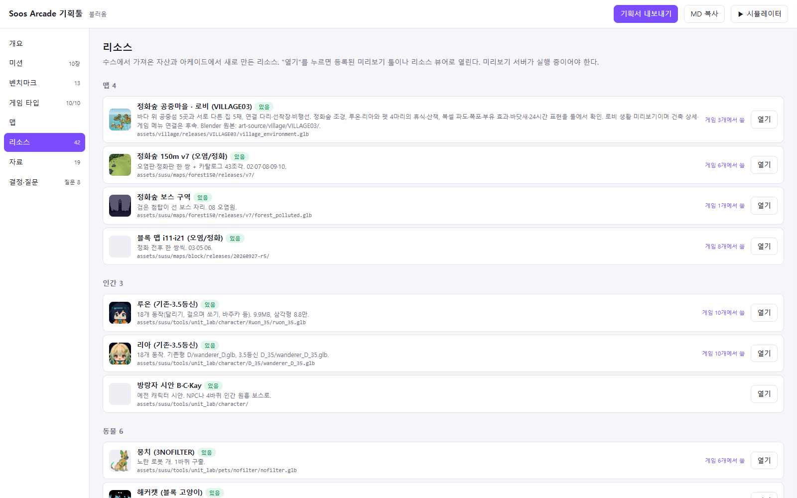
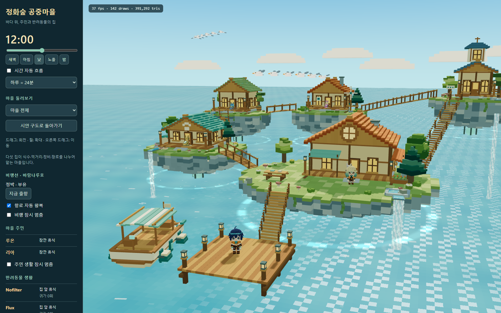

# 작업 보고서 — 플래너 로비 섬 해안 → 정화숲 공중마을 교체

작성: Codex · 2026-10-10

## 한 줄

사용자가 지정한 기존 `m_lobby` 항목을 VILLAGE03 공중마을로 교체하고, 실제 모델·Blender 원본·코드 보관본을 수스 아케이드에 복사했다. 브라우저에서 이미지, 모델 제공과 미리보기 실행을 확인했다.

## 작업 위치

- 최초 생성·현재 미리보기 실행 프로젝트: `C:\Users\dmaxd\Downloads\xoox-master\xoox-master`
- 플래너·리소스 등록 프로젝트: `C:\soos-arcade`
- 기획툴 정본: `C:\soos-arcade\planner\data.json`
- 등록 확인: http://localhost:4174/planner/?v=8#resources
- 실행 툴: http://127.0.0.1:5180/village-lobby-tool.html?revision=VILLAGE03-final

## 바꾼 파일

| 위치 (C:\soos-arcade 기준) | 내용 |
|---|---|
| planner/data.json | `m_lobby`의 이름·설명·모델 경로·미리보기·열기 URL 교체. 공식 PUT /api/data 사용 |
| planner/index.html | tool 필드의 http/https 절대 URL 지원. 기존 상대 툴 경로 처리는 유지. 리소스 안내 문구 갱신 |
| assets/village/releases/VILLAGE03/ | 환경 GLB, 새 GLB, 내비 GLB, layout/navigation/settings JSON 6개 |
| art-source/village/ | Blender VILLAGE01/02/03 원본, 생성·검증 스크립트와 원본 설명서 |
| art-source/village/runtime-snapshot/ | 파도·시간·부유·폭포·비행선·새·주민·펫 생활 코드와 HTML 보관본 |
| assets/village/README.md | 원본 생성 위치, 아케이드 등록 경로, 실행과 의존 자산 설명 |
| docs/plans/20261010_공중섬마을_제작계획_Codex.md | 기존 제작 계획 복사 |
| docs/reports/20261010_작업보고서_마을생활_부유폭포_비행선_Codex.md | 기존 VILLAGE03 제작 보고 복사 |
| docs/reports/assets/20261010_village03/ | 기존 낮·밤·노을·생활·내비·비행선 캡처 및 검증 결과 복사 |
| docs/기획서.md | 플래너의 공식 기획서 내보내기로 재생성 |
| docs/status/BOARD.md | Codex 상태와 이번 보고 경로 |

이번 등록 보고는 생성 프로젝트의 같은 docs/reports 경로에도 남겼다.

## 핵심

- 잘못된 해안 맵은 더 이상 로비 항목의 모델이나 열기 대상으로 사용하지 않는다. 표시 이름은 **정화숲 공중마을 · 로비 (VILLAGE03)**이다.
- 기존 항목 ID `m_lobby`를 유지했다. 리소스 총 42개이며 중복 항목을 추가하지 않았다. 다른 리소스와 게임·미션·맵·자료·결정 등 플래너 데이터는 변경하지 않았다.
- 44개 파일, 약 60.34 MiB를 복사하고 전부 SHA-256 대조했다. 기존 아케이드 assets/susu의 주민·펫·숲 GLB 참조 16개도 생성 프로젝트와 일치한다.
- 모델 등록 경로는 아케이드의 `assets/village/`이다. 동적 생활 미리보기는 기존 생성 프로젝트의 5180 서버로 연결된다. 이번 작업은 게임 본편이나 5190 툴 서버에 마을 코드를 통합하는 단계가 아니다.
- 기존 해안 파일은 보관되어 있으며 플래너가 저장할 때 이전 data.json도 자동 백업한다. 별도로 이번 교체 전 데이터와 HTML을 보고 자산 폴더에 남겼다.
- 건축 상세 보완과 실제 게임 메뉴 연결은 이전 VILLAGE03 보고대로 후속 단계다.

## 검증

1. 실제 플래너 리소스 화면에 교체한 항목이 하나만 표시되고 이전 해안 항목명은 사라졌다.
2. 미리보기 이미지가 로드되었다.
3. 복사한 GLB·JSON 6개를 플래너 서버로 요청해 HTTP 200과 파일 해시 일치를 확인했다. GLB 헤더·길이와 JSON 파싱도 확인했다.
4. 해당 행의 **열기** 버튼을 실제 클릭해 현재 공중마을 툴이 열리고 준비 완료 상태까지 확인했다.
5. 기존 정화숲 열기 URL은 `http://localhost:5190/forest-play-tool.html`로 유지된다.
6. 기획툴과 마을 툴에서 JavaScript 실행 오류가 없었다. 공식 기획서 내보내기도 성공했다.

검증 자료: [browser_registration_validation.json](assets/20261010_planner_village/browser_registration_validation.json), [copy_manifest.json](assets/20261010_planner_village/copy_manifest.json), [registration.json](assets/20261010_planner_village/registration.json).

## 스크린샷

### 교체된 플래너 항목

### 열기 버튼으로 실행한 공중마을

## 막힌 질문

없음. 이번 등록 교체 작업 완료.
