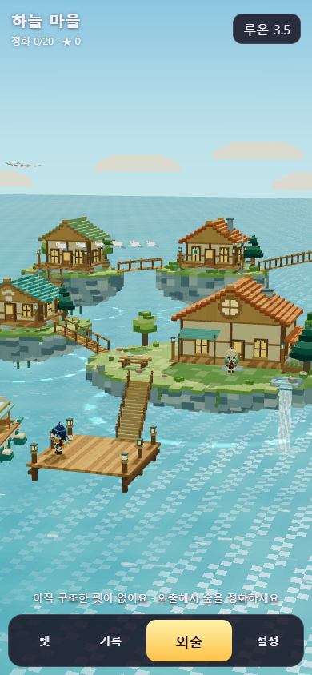
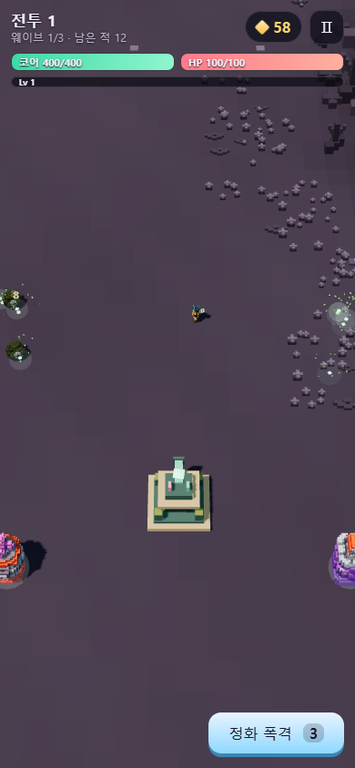
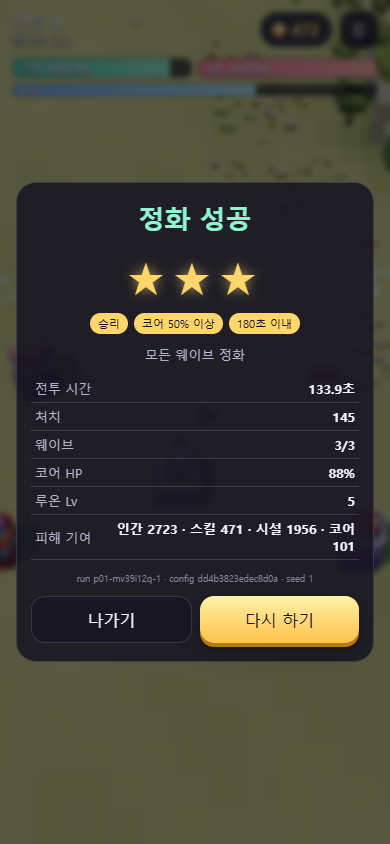
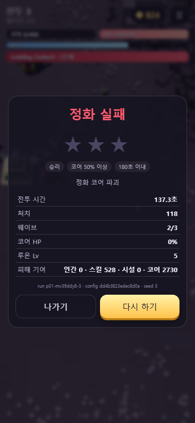
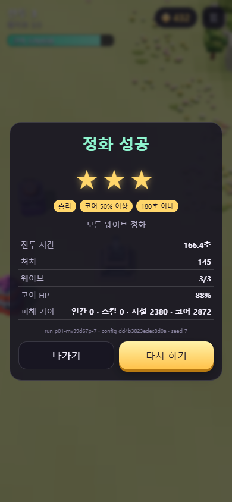
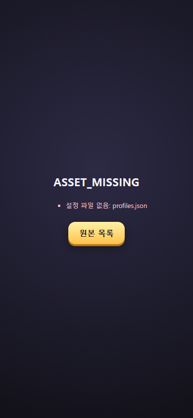

# 검토 보고서 — Claude 아케이드 M0·M1·M2 구현

작성: Codex · 2026-10-11  
검토: 한국시간 12:12 예약 실행, 약 12:13~12:34  
원본: C:\soos-arcade  
판정: **제작 방향은 이해했고 p01 실제 판은 동작한다. M0~M2 전체 완료 승인은 보류한다.**

## 1. 한 줄 결론

기존 수스 3D 자산으로 로비·카드·정화 코어 방어를 연결한 것은 확인했다. 그러나 **시험 결과의 캠페인 저장, 미션/프로필 불일치 허용, 사망한 적의 예약 공격 발동, 배포 자산 누락**을 먼저 고쳐야 한다. 카드 중복 선택·포커스 상실·화상·진화 제한도 수정 대상이다. 기획툴 편집/플레이 브리지와 세션 수명관리·이동 리플레이는 아직 완료되지 않았다.

이 보고서는 검토 결과다. Claude 런타임·표·모델은 수정하지 않았다. 이번 일회 검토 자동화는 보고 후 삭제한다.

## 2. 기준과 확인한 변경

기준: [인계 README](../plans/20261011_3D제작명세_v2_대표4종_Codex/README.md), 00·02·04·05·06·11·13 문서, 관련 데이터·08 공격 취소 계약, handoff-baseline.v2.json. 비교 보고: [Claude M0M1M2 보고](../작업완료보고서/2026-10-11_아케이드원본_M0M1M2.md).

- 10:10:50 KST 기준 파일 46개: 누락 없음. 변경은 vite.config.ts 한 개(아케이드 HTML 빌드 엔트리 추가).
- 새 src/arcade 파일 30개, 독립 HTML 7개. 기존 planner/index.html·planner/server.js·planner/data.json 및 기존 게임 코드는 기준 해시와 같다.
- 자산 manifest의 **1,503개 파일 전체**: 누락 0, 해시 변경 0. 기존 캐릭터·펫·맵 디자인을 임의로 다시 만들거나 삭제한 증거 없음.
- v2와 대응하는 배포 설정 **14개 JSON 내용 동일**. 하지만 표가 같다는 사실과 코드가 그 값을 실제로 따르는 것은 다르다. 화상/속사 등의 불일치는 아래에 기록했다.
- hash: dd4b3823edec8d0a, buildId: arcade-m1-20261011.
- 무결성 원문: [integrity.json](assets/20261011_Claude_M0M1M2_Codex/integrity.json).

## 3. 단계별 진행 판정

| 단계 | 확인한 것 | 판정 / 남은 조건 |
|---|---|---|
| M0 | 설정 합성·불변 스냅샷·해시·60틱·분리 RNG·기존 자산 로딩·미구현 오류 | 부분 충족. 브리지·의미 검증·실제 총구 소켓·수명관리·입력 리플레이·시험 격리 미완료 |
| M1 | 준비/건설/강화/3웨이브/보스/XP/카드/궁극기 코드, 정상 규칙 승리·코어 실패·재시작 | 플레이 가능한 상태. 아래 재현 결함 때문에 완료 승인 보류 |
| M2 | 실제 마을 로딩·외출·카드·p01 진입·결과·나가기·기록 저장 | 기본 흐름 동작. 저장 자격 검증·배포·펫 구조/선택·기획툴 연결까지 완성했다고 볼 수 없음 |
| M3 | p03 미구현 표시 | 다음 단계. 이번 완료 주장 범위 밖 |
| M4 | p02 데이터에서 p01 상속, FPS 미구현 표시 | FPS 엔진 복제 증거 없음. 실제 FPS 동일 판정/총구/조작은 아직 검수 불가 |
| M5 | p04 미구현 표시, CHAIN01 준비 자산 보존 | 다음 단계. 숫자/경계/대열 판정은 아직 검수 불가 |
| M6 | 20미션 표·기존 49종/5펫 자산 보존 | 전체 지역·49종 행동·동행 펫 전투·구저장 변환·실기기 성능 미검수 |

현재 성공 반환 스텁으로 게임 2~4를 완료한 척하는 코드는 발견하지 않았다. 세 페이지는 NOT_IMPLEMENTED를 표시한다. p01에 전투가 들어간 것은 확인되지만 공통 Combat/Card/Spawn을 나머지 규칙에 주입하는 서비스 경계는 아직 정리되지 않았다. BaseDefense 안에 전투·적 AI·성장이 모여 있고 Actors가 Three/PlayCharacter에 의존하므로 보고서의 “three를 모르는 순수 규칙”은 직접 import만 없다는 수준이다.

## 4. 실제 실행 증거

### 방법과 한계

인앱 화면 도구는 kernel/setup refresh 오류로 두 번 실패했다. 기존 설치된 Playwright와 **격리한 headless Chrome**, 390×844 CSS 화면으로 대체했다. 사용자 브라우저 프로필·저장은 사용하지 않았다.

건설·전투 시작·일시정지·재시작·출항·미션 진입·나가기 버튼과 키보드 이동은 실제 UI로 조작했다. 완주 시험은 기존 __arcade.fast 손잡이와 자동 이동/카드/시설 명령을 사용했다. HP·공격력·표를 올리거나 무적을 켜지는 않았지만 **봇/가속 시험이며 사람 플레이 밸런스 검수가 아니다.** 계약 시험에서만 메모리상의 격리 시뮬레이션/가짜 world/합성 입력을 사용했다.

| 시험 | 결과 | 근거 |
|---|---|---|
| 목록·로비·카드·game1 로딩 | 모두 실행, 화면 JS 오류/실패 요청 없음 | screen-probe.json |
| game2~4 | 명시적 NOT_IMPLEMENTED, 성공 스텁 없음 | 같은 원문·페이지 캡처 |
| 일반 p01, seed 1, 시설+자동 이동 | 승리 3별, battleSec 133.95, 145처치, 코어 88%, HP 100, Lv5 | additional-tests.json |
| 시설만, seed 7 | 승리 3별, battleSec 166.38, 145처치, 코어 87.7%, 인간 없음 | gameplay-tests.json |
| 기본 규칙·시설 없음, seed 3, 인간을 구석으로 이동 | 코어 파괴 실패, battleSec 137.33, 118처치, 0별 | gameplay-tests.json |
| 결과의 “다시 하기” | 준비1·웨이브0·HP400·Lv1·새 runId | gameplay-tests.json |
| 로비→외출→카드→p01→일시정지→나가기 | 카드 지역1로 귀환, campaign mode, 동일 configHash | flow-test.json |
| 일시정지 | 클릭 후 tick 14→14로 유지 | flow-test.json |
| 범위포 착지 | 비행 .74초 동안 두 대상 HP1000, 착지 후 둘 다978.4. 직격+폭발 중복 없음 | additional-tests.json의 격리 계약 시험 |
| 동일 스냅샷/seed/초기명령/입력 반복 | 첫 웨이브 표본의 시간·피해·처치·HP 일치 | additional-tests.json. 전체 판/FPS 재현 보장은 아님 |
| 지면 높이 | 코어/4시설/이동 위치 등 8개 표본에서 모델 바닥≈0, height()=0 | gameplay-tests.json. 현재 평지에서 높이 오류는 확인되지 않음 |

지면 높이 서비스는 0 고정이고 다른 맵의 경사/다리 대응은 남아 있다. 이번 p01 평지 표본이 일치하므로 현재 배우가 땅에 묻힌다는 결함으로 분류하지 않는다.

### 캡처

로비(주민 2명, 구조 전 펫 0마리)와 p01 전투:

정상 규칙 승리 / 코어 파괴 실패:

시설만 승리와 배포 자산 누락:

원문: [화면 로딩](assets/20261011_Claude_M0M1M2_Codex/screen-probe.json), [승패·입력·카드·효과](assets/20261011_Claude_M0M1M2_Codex/gameplay-tests.json), [일반 완주·범위포·설정·입력 로그](assets/20261011_Claude_M0M1M2_Codex/additional-tests.json), [연결 흐름·진화](assets/20261011_Claude_M0M1M2_Codex/flow-test.json), [배포 시험](assets/20261011_Claude_M0M1M2_Codex/dist-test.json).

모든 완주 캡처의 runId/seed/hash는 화면과 JSON에서 대조할 수 있다. 캡처는 해당 시험 시점 화면이다. 자동 진행 중 모든 렌더 프레임을 재생한 영상은 아니다.

## 5. 수정 우선순위

### P1-01. 시험판/봇 결과가 캠페인 진행으로 저장됨

위치: [DefenseApp.ts:73](C:/soos-arcade/src/arcade/app/DefenseApp.ts:73), [RunStore.ts:22](C:/soos-arcade/src/arcade/app/RunStore.ts:22).

미션 파라미터 없이 실행하면 snapshot.mode=plannerTest다. 그런데 결과는 무조건 RunStore.record에 전달되고, win이면 미션 cleared/bestStars가 저장된다. 시설만 가속 시험에서 r01-p01 cleared=true, bestStars=3이 **실제로** localStorage에 생겼다. RunResult에는 mode/debugFlags도 없다. fast는 테스트 사용 사실을 표시하지 않는다.

권장: 결과까지 mode/debugFlags/testOnly를 전달하고, 저장 입구에서 campaign+정상판만 개방/별/구출을 지급한다. fast/봇/live patch는 판 전체를 testOnly로 표시한다. runId 중복 저장도 같은 결과를 재반영하지 않도록 막는다. 테스트 기록 자체는 별도 로그로 남긴다.

### P1-02. 다른 프로필의 미션 ID를 받아 클리어할 수 있음

위치: [ConfigStore.ts:101](C:/soos-arcade/src/arcade/config/ConfigStore.ts:101).

profileId=p01, missionId=r01-p04로 snapshot을 요청했는데 오류 없이 p01 규칙에 p04 미션 ID가 들어왔다. mission 존재 여부만 찾고 profileId 일치/현재 개방 여부를 검사하지 않는다. 잘못된 ID는 조용히 지역1 기본 미션으로 대체된다.

이 상태에서 p01 승리가 p04 클리어로 저장될 수 있고, CardsApp/LobbyApp의 rescuePetId 처리로 이어질 수 있다. **미션 불일치 수락은 재현했고, 잘못된 p04 저장/펫 구조까지 전 과정을 실행한 것은 아니다.**

권장: 명시된 미션이 없거나 profileId가 다르면 CONFIG_INVALID. campaign 저장 전에 미션·프로필·개방 상태·설정 버전을 검증한다. 잠긴 판을 시험 실행하려면 plannerTest로만 허용한다.

### P1-03. 예고 중 죽은 적의 공격이 나중에 발동함

위치: [BaseDefense.ts:923](C:/soos-arcade/src/arcade/rulesets/BaseDefense.ts:923), [BaseDefense.ts:977](C:/soos-arcade/src/arcade/rulesets/BaseDefense.ts:977).

Hazard에 ownerId가 있지만 stepHazards가 주인의 생존/공격 취소 상태를 검사하지 않는다. kill도 예약 hazard를 취소하지 않는다. 주인이 죽기 전 만든 0.5초 예고 장판을 발동 전에 주인 처치한 격리 시험에서, 0.6초에 인간 HP100→80이 됐다.

08문서의 HP0 즉시 공격 예약 취소와 충돌한다. 보스 예고를 끊어도 피해가 나오는 상황이다.

권장: 미발동 공격에 owner+attackToken을 연결하고 사망/중단 시 취소한다. 이미 발사된 탄/활성 장판의 지속 여부는 별도 정책으로 구분한다. 보스 마지막 처치와 같은 틱의 실패 우선순위도 함께 시험한다.

### P1-04. 개발 화면은 되지만 배포물이 실행되지 않음

위치: [vite.config.ts:9](C:/soos-arcade/vite.config.ts:9), [ConfigStore.ts:6](C:/soos-arcade/src/arcade/config/ConfigStore.ts:6).

현재 설정 그대로 vite build를 실행하면 combatSkillTool의 top-level await가 기본 target에서 실패한다. 이 툴 코드는 기준 해시와 같아 **Claude가 새로 만든 오류로 귀속하지 않는다.** 다만 실제 배포 검수 게이트는 실패다.

원본을 바꾸지 않고 별도 폴더에서 --target esnext 진단 빌드를 생성했다. 빌드 자체는 성공했으나 /assets/arcade/config, /assets/maps, /assets/village가 dist에 없다. 설정13개 요청이 404이고 game1은 ASSET_MISSING 화면에서 멈췄다. publicDir가 assets/susu만 복사하고 새 폴더의 동적 URL은 빌드 입력으로 추적되지 않는다.

권장: 목표 브라우저에 맞게 기존 툴의 await/빌드 target 문제를 해결하고 새 자산의 명시적 배포/manifest 경로 변환을 추가한다. dev뿐 아니라 정적 dist에서 로비·카드·게임을 다시 검수한다. 진단용 esnext 성공을 정식 빌드 통과라고 기록하지 않는다.

### P2-05. 카드 더블클릭이 다음 레벨 카드까지 고름

위치: [DefenseHud.ts:184](C:/soos-arcade/src/arcade/ui/DefenseHud.ts:184).

onclick마다 120ms 타이머를 만들고 선택 잠금이 없다. XP80으로 여러 강화가 대기한 격리 UI에서 첫 카드 하나를 더블클릭했더니 picked에 p:hp:1과 w:ice-rocket:1이 둘 다 들어갔다. 두 번째 지연 명령이 이미 열린 다음 카드의 같은 index를 선택했다.

권장: 첫 클릭 즉시 전체 선택 버튼을 잠그고 choiceGeneration/고유 cardId를 검사한다. 첫 선택의 확인 연출이 끝난 뒤 다음 draft를 연다. 명세의 250ms 확인+100ms 입력 차단도 반영한다.

### P2-06. 포커스 상실 때 이동키가 유지됨

위치: [Input.ts:40](C:/soos-arcade/src/arcade/core/Input.ts:40), [DefenseApp.ts:56](C:/soos-arcade/src/arcade/app/DefenseApp.ts:56).

숨김은 HUD가 일시정지하지만 window blur/키 상태 해제는 없다. 실제 D keydown 후 blur 이벤트를 보낸 시험에서 tick34→65, x2.55→4.875로 이동했고 paused=false였다. 키보드 keyup을 받지 못하는 창 전환에서 의도하지 않은 이동이 계속될 수 있다. blur 시험은 합성 이벤트이며 실제 운영체제 창 전환을 직접 조작한 것은 아니다.

권장: blur/focus 이유를 시계에 연결하고 keys/joy/pendingTap을 해제한다. 복귀해도 새 입력 전까지 움직이지 않는다.

### P2-07. 화상 수치와 피해 기여의 원래 주인이 틀림

위치: [BaseDefense.ts:876](C:/soos-arcade/src/arcade/rulesets/BaseDefense.ts:876), [BaseDefense.ts:950](C:/soos-arcade/src/arcade/rulesets/BaseDefense.ts:950).

명세는 .5초마다 raw2 피해인데 코드가 폭발 피해×.2를 DPS로 사용한다. 시설 raw24 공격의 화상 틱은 raw2.4가 됐다. armor=.9 대상에서 실제 틱은 2.16(978.4→976.24), 명세값이면 1.8이다. 업그레이드에 따라 화상까지 임의로 커진다.

상태도 kind만으로 합쳐 최대 DPS를 유지하면서 owner는 마지막 재적용의 category로 덮는다. 강한 skill 화상에 약한 facility 화상을 덧입힌 시험에서 강한 피해9가 전부 facility 기여로 기록됐다.

권장: 원소 표의 피해/틱/지속을 읽고 casterId+skillId 단위로 갱신한다. 소유자와 sourceShot은 원래 출처를 유지한다. DamageEvent의 ownerId/projectileId/raw/applied/killed 등 필드도 보완한다. 실제 HP를 넘는 피해량은 더하지 않는 현재 clamp는 유지한다.

### P2-08. “카드당 진화 1장”을 “판 전체 진화 1개”로 제한함

위치: [Cards.ts:85](C:/soos-arcade/src/arcade/systems/Cards.ts:85).

lo.evolved.size < maxEvolutionCards로 후보 생성을 막는다. fire-pillar를 이미 소유하고 bolt-home Lv5+cooldown Lv1이 있어도 chain-three가 제시되지 않았다. 명세는 각 3택에서 진화 카드 최대1장 우선 배치이며 판 전체의 다른 무기 진화를 금지하지 않는다.

권장: 최대1장은 이번 draft의 진화 후보 수에만 적용한다. 교체된 슬롯·Lv5 배율을 다시 곱하지 않는 계약과 함께 네 진화의 개별/복수 소유 시험을 추가한다.

### P2-09. M0 서비스·기획툴·수명관리 완료 근거 부족

위치: [DefenseApp.ts:87](C:/soos-arcade/src/arcade/app/DefenseApp.ts:87), [BaseDefense.ts:152](C:/soos-arcade/src/arcade/rulesets/BaseDefense.ts:152), [DefenseView.ts:528](C:/soos-arcade/src/arcade/views/DefenseView.ts:528).

- planner에는 새 arcade 브리지/편집/publish/run API가 없다. 기존 planner 기준 파일도 그대로다. 독립 플레이 페이지를 만든 것과 기획툴에서 모든 파트를 조절·플레이하는 구조를 완성한 것은 별개다.
- startDefense가 세션 핸들을 반환하지 않고 RAF·resize·canvas pointerup·HUD visibility listener·타이머 정리 경로가 없다. renderer.dispose만으로 actor/scene/GPU/cache/비동기 로드를 모두 정리하지 못한다. 실제 단일 페이지 전환20회 누수는 이번에 측정하지 않았으나 재사용/iframe 세션 종료 계약은 충족하지 않는다.
- sim.log는 Command만 남긴다. 이동 입력으로 위치가 x0→.075 바뀐 시험에서 log=[]였다. 전체 InputFrame 기록과 재생/JSON export가 필요하다.
- ConfigStore에 일부 시설/스폰 검사는 있지만 공통 수치·스킬·정책의 완전한 의미 검증이 없다. hero.hp=-1 설정도 snapshot이 허용했다.
- 수치를 표로만 관리한다는 보고와 달리 시설 비행/장전·화상·보급 풀 등에 코드 상수가 남아 있다.

권장: 공개 GameSession(load/start/pause/step/getResult/dispose) 경계와 실제 입력/사건 로그를 만들고, 검증·자산 소켓·브리지·세션 종료를 M0 게이트로 다시 제출한다. 다음 게임을 별도 전투 엔진으로 복제하지 말고 공통 서비스를 추출해 연결한다.

### P2-10. 총구·공격 주기·화면 읽힘 보완

위치: [BaseDefense.ts:433](C:/soos-arcade/src/arcade/rulesets/BaseDefense.ts:433), [BaseDefense.ts:444](C:/soos-arcade/src/arcade/rulesets/BaseDefense.ts:444), [DefenseView.ts:411](C:/soos-arcade/src/arcade/views/DefenseView.ts:411).

- 표적이 없어도 FIRING 시간이 흘러가는 코드다. 표적 없는 2초 입력에서 streamCycle=2였다. 명세는 무표적일 때 FIRING을 멈추고 재개 즉시1발, REST만 계속 진행한다.
- 기본탄은 인간 위치에서 하드코딩한 좌우 offset으로 나온다. 로켓 muzzle FX도 인간 중심이며 Fx.y를 렌더가 사용하지 않는다. 실제 gun/gunL/launcher 소켓 검수 경로가 없다.
- 현재 사진에서 인간/적이 매우 작고 인간 추적 중 좌우 시설 외형이 화면 밖으로 일부 잘린다. 보고서에서도 작은 몬스터를 한계로 인정했다.
- 시설은 구운 단일 메시 전체를 회전/상하 이동한다. 기존 투석기의 팔 장전→발사→회복, 포탑 base/barrel 분리 모션을 연결한 것은 아니다.

권장: 발사 판정과 렌더에 같은 총구 transform을 전달하고 발사/휴식 상태기를 계약대로 구현한다. 기존 모델·리그를 유지한 채 바주카/양손·팔·총구 FX를 연결한다. 카메라의 실제 시설 bounds와 위험 구역을 검수한다. 단순 HP 상향이나 캐릭터 디자인 변경으로 대체하지 않는다.

## 6. 아직 결정/확인이 필요한 항목

Claude가 보고한 임시 설계: 미구현 선행 미션 건너뛰기, 시설만 보급 풀, 궁극기 조준 중 정지, 웨이브 종료 XP 자동 회수, 오염 맵에 정화 조명. 보고서에 공개돼 있으므로 숨긴 변경이라고 판단하지 않는다. 다만 승인된 정본인지 별도 결정이 필요하다. 특히 미구현 카드를 넘기는 경로는 테스트 개방과 정식 캠페인을 구분해야 한다.

보고서에 없는 완성도를 추정하지 않았다:

- 인간 HP0에 의한 실제 플레이 실패, 모든 7무기/4진화 실전 완주, 최대 성장/fallback, 모든 시설 모션/궁극기 취소·중복, 혼잡 최대80의 접근 슬롯 보장은 추가 검수 필요.
- 현재 코드의 분산·3경로·속도 차이는 확인. 최악 혼잡/한 점 집결을 막는 전역 보장 및 작은 예고를 실제 사람이 읽는지는 미검수.
- 첫 웨이브 반복 시험은 일치했지만 전체 판의 로그 재생·30/60/120 렌더 비교·FPS 동일성까지 보장하지 않는다.
- 실제 휴대전화 터치/멀티터치/GPU/발열·20회 전환 메모리·접근성은 미검수. 데스크톱 headless의 390×844는 휴대전화 성능 검증이 아니다.
- 펫0 상태가 정상인 첫 지역만 실제 연결 검수했다. 5펫 구조/선택/동행·구저장 마이그레이션은 아직 검수 불가.
- 소리·튜토리얼·카드 그림·동행 펫 전투는 Claude도 미완료로 적었다. 이를 완료로 인정하지 않는다.
- p03/p04/FPS의 플레이 계약은 구현 전이며 pending 화면만 확인했다.

## 7. 권장 다음 작업 순서

1. P1 저장 자격·미션 일치·예고 취소를 먼저 수정하고 해당 재현을 다시 통과.
2. 정식 build와 새 자산 dist 로딩 통과.
3. 카드 단일 선택·포커스·화상·진화·속사/총구·시설 모션 수정.
4. M0 세션 종료·입력 로그·검증·기획 브리지 보완. 해당 기능을 “완료” 보고에 다시 제출.
5. 실제 사람이 무적/봇/fast 없이 p01 승리·코어 실패·인간 실패·재도전. 카드/시설·예고가 읽히는 화면과 로그 제출.
6. M0~M2 게이트를 닫은 뒤 M3 p03 → M4 FPS → M5 p04 → M6 확장.

범위를 임의로 바꾸거나 다른 AI에게 메시지를 보내지는 않았다. 이 문서의 권장안은 다음 제작 담당자가 확인할 수정 사항이다.

## 8. 이번 검토에서 남긴 파일과 실행

- 보고서: docs/reports/20261011_검토보고서_Claude_M0M1M2_Codex.md
- 증거: docs/reports/assets/20261011_Claude_M0M1M2_Codex/ (PNG·JSON·타입 검사·검토 스크립트)
- 상태: docs/status/BOARD.md의 Codex행만 검토 완료로 갱신.
- 원본 실행 주소: http://127.0.0.1:5190/arcade.html
- 서버 실행: C:\soos-arcade에서 node node_modules/vite/bin/vite.js --host 127.0.0.1 --port 5190 --strictPort
- 타입 검사: node node_modules/typescript/bin/tsc --noEmit -p tsconfig.json → 기존 src/tools/combatSkill/main.ts:1004 TS7006. src/arcade 오류는 출력되지 않았다.
- 정식 빌드: node node_modules/vite/bin/vite.js build --outDir <별도 검토 폴더> → 기존 combatSkillTool top-level await target 오류.
- 진단 빌드: 위 명령에 --target esnext → 빌드 성공, 새 설정/맵/마을 미복사로 실행 실패.
- 원본 설정/런타임/자산·Claude행은 변경하지 않음. C:\xoox·CodexPack·그룩 루틴·커밋/푸시·Claude 채팅 메시지 전송 없음.

스크립트는 당시 로컬 설치 Playwright와 scratch 경로를 사용한 원문이다. 재실행할 경우 서버를 켜고 진단 dist 경로를 해당 환경에 맞춰야 한다. 완료 판정을 위한 테스트 결과이며 새 게임 기능 파일이 아니다.
