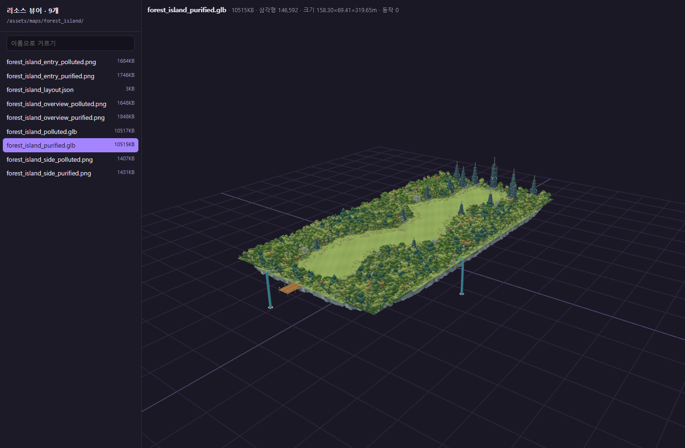
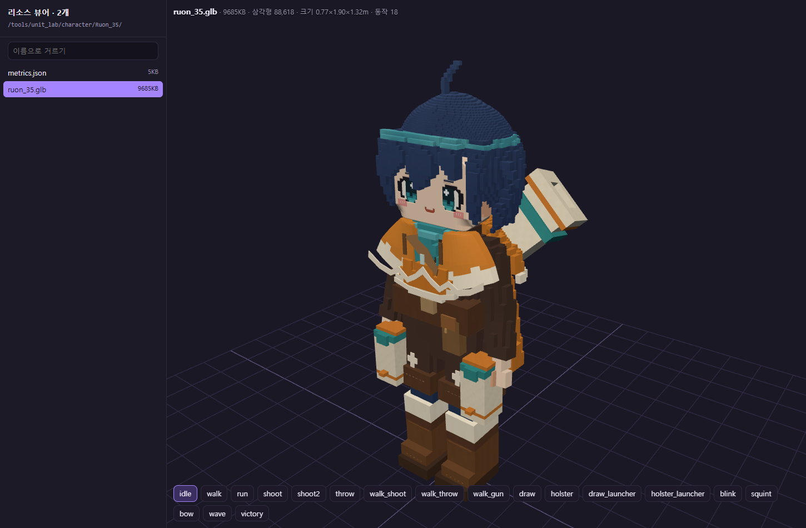

# 작업 보고서 — Claude 최신 3D 계획·리소스 재검토

작성: **Codex** · 2026-10-11  
프로젝트: `C:\soos-arcade`  
지시: 수스에서 사용한 3D 소스로 제작한다. Claude가 만든 최신 계획과 리소스를 다시 확인한다.

## 1. 한 줄

**현재 정본은 수스의 3D·복셀 자산을 쓰는 방향이다. 원본 사본과 새 맵은 실제로 준비되어 있으며, 미션 8개에 사용할 3D 맵 연결이 등록됐다. 남은 핵심은 해당 자산을 실제 게임 실행 규칙에 연결하고 오래된 참조·구역 수치를 정리하는 일이다.**

## 2. 최신 제작 기준

정본 `planner/data.json`의 결정 d11~d14를 확인했다.

- 캐릭터, 반려동물, 맵, 몬스터, 건물은 3D 복셀 자산을 사용한다.
- 적은 수스 유닛 랩의 복셀 몬스터 45종과 복셀 UFO 4종을 사용한다.
- 일반 몬스터 GLB·저폴리 팩·독립 2D 이미지와 스프라이트는 실제 게임 사용 대상에서 제외되어 있다.
- 기존 하늘 이미지는 3D 맵 배경에 적용된 자산으로 남아 있다.
- 새 정화숲 공중섬 하나에서 05·07·08·09·10번 미션이 각각 구역을 사용한다.
- 실제 게임을 검증하는 실행 툴에도 동일한 3D 모델·전투 소스를 연결하는 것이 사용자 지시와 맞는다.

출처는 두 가지로 구분해야 한다. 사람·펫·적·숲 자료는 기존 수스 원본을 복사했다. Claude의 미션 맵은 그 숲 원본 또는 카탈로그를 재사용하고, 공중섬 밑면·다리·선착장·소품 등 새 3D 형상을 보완한 결과물이다. 모든 신규 GLB가 수스에 있던 파일의 단순 사본인 것은 아니다. 로비 VILLAGE03도 이번 아케이드에서 별도로 승인·제작된 자산이다.

## 3. Claude 최신 작업과 실제 파일

| 사용할 미션 | 현재 3D 준비 | 파일 위치 |
|---|---|---|
| 01 상륙 | 60×60m 상륙 공중섬, 정화/오염 한 쌍 | `assets/maps/landing/` |
| 02 방 돌파 | 숲길 방 6종, 각 정화/오염 한 쌍 | `assets/maps/forest_rooms/` |
| 04 호위 | 공중섬 5개·다리·갈림길의 120m 구름다리길 | `assets/maps/sky_route/` |
| 05·07·08·09·10 | 원본 정화숲 150×300m를 띄운 큰 공중섬, 정화/오염 한 쌍 | `assets/maps/forest_island/` |
| 03·04·05·07에서 사용할 소품 | 정화 수레·등대·신호탑, 각각 한 쌍 | `assets/maps/props/` |
| 03 폐허 | 맵 설정 있음, 아직 파일 연결 없음 | 미제작 |
| 06 지하 | 맵 설정 있음, 파괴·설치용 런타임 블록 데이터 제작 필요 | 미제작 |

새 미션 맵·소품 GLB는 **24개**다. 모두 glTF 2.0 헤더·전체 길이가 정상이고 외부 버퍼/이미지 의존성이 없다. 정본의 맵 경로 표현식을 실제 파일명으로 펼쳐 대조해 01·02·04·05·07·08·09·10의 파일이 존재함을 확인했다. 이는 8개 게임의 플레이 완료를 뜻하지 않는다.

정화숲 공중섬은 스크립트에서 `forest_polluted.glb`와 `forest_purified.glb` 원본을 실제로 가져온다. 숲 위치에 (-75, -150, +32m)를 적용하고 밑면·코어·폭포·부두를 더한다. `EXT_mesh_gpu_instancing`을 사용하며 각 파일은 약 10.3 MiB다. 원본과 제작 스크립트는 `art-source/maps/`, `scripts/maps/`에 있다.

## 4. 수스 원본·모델·복셀 데이터 검사

### 원본 사본

`assets/susu/` 현재 파일은 1,362개, 약 647.42 MiB다.

- `C:\xoox\data`와 상대 경로가 대응하는 **1,355개 파일 전부 SHA256 일치**. 달라진 파일 없음.
- 캐릭터 문서 6개는 `C:\xoox\docs\characters`에 있으며 사본과 전부 SHA256 일치.
- 나머지 `_index.json` 1개는 툴의 생성 색인이다. 이를 원본 3D 리소스 누락으로 분류하지 않았다.

### 활성 목록과 모델

정본 리소스 49항목: **있음 30 / 확인 필요 1 / 사용 안 함 18**. 사용 대상과 확인 필요 항목의 경로 31개는 모두 존재한다. `확인 필요`의 방랑자 옛 시안은 경로가 있어도 게임 사용 확정으로 취급하지 않는다.

- 루온·리아 3.5등신 GLB: 각 **18클립**. idle/walk/run, 두 사격, 던지기, 이동 중 사격·던지기, 발도·납도, 표정·인사·승리 포함.
- NoFilter·Flux·Lumos·Gizmo: 각각 **8클립**, 달리기와 앉기/서기 전환 포함.
- 기존 블록 고양이: **6클립**. 걷기·앉기·둘러보기·공격·앉기/서기 전환이 있으며 `run`과 `idle_stand`는 없다.
- 복셀 몬스터 **45종**과 UFO **4종**: 카탈로그와 각 `.json`·`.dense.bin` 데이터가 모두 존재한다.
- 복셀 건물·타워·캠프·기계 조각도 기존 `units_free` 카탈로그에 있다.

## 5. 실제 3D 로드 확인

기존 서버의 리소스 뷰어에서 분리된 브라우저 환경으로 확인했다.

1. `http://localhost:5190/viewer.html?src=/assets/maps/forest_island/forest_island_purified.glb`
2. `http://localhost:5190/viewer.html?src=/tools/unit_lab/character/Ruon_35/ruon_35.glb`

정화숲 공중섬의 GPU 인스턴싱 모델과 루온 모델이 화면에 표시되었고, 루온의 18개 동작 버튼도 생성됐다. 검사한 두 화면에서 페이지 오류·요청 실패는 없었다. 전체 게임의 승패, 모든 동작의 시각 품질, 모바일 성능을 완료 검사한 것은 아니다.

## 6. 계획·리소스 연결에서 정리할 부분

### 6.1 새 맵과 사용 목록의 불일치

미션의 `mapId`는 신규 맵 설정으로 연결되어 있지만 게임 타입의 `uses` 목록에는 신규 자산 연결이 덜 반영됐다.

- g01: 신규 `n_landing`.
- g02: 신규 `n_rooms`.
- g04: 신규 `n_route`와 `n_props`.
- g05·g07·g08·g09·g10: 신규 `n_forest_island`와 필요한 `n_props`.

현재 일부 목록은 옛 `m_lobby`·`m_block`·`m_forest` 위주다. 공통 자산 참조는 유지할 수 있으나, 실제 실행 맵과 소품을 한 번에 찾도록 새 자산 관계를 표시해야 한다.

g08은 `사용 안 함`인 **`c_matter`(2D 오염물질 그림)**를 아직 `uses`에 포함한다. 현재 3D 기준에 맞춰 실제 복셀 보스 자산을 연결해야 한다.

### 6.2 공유 공중섬과 게임 수치

GLB 형상과 실제 플레이 구역은 구분해야 한다.

- 숲 공중섬 배치의 건설 자리는 **전체 5곳**이다. g07은 **8칸**을 요구한다.
- 05 입구의 설명 범위(y -150~-60) 안에 현재 건설 자리 좌표는 **1곳**이다. 기존 미션 기획의 복수 건설 칸과 맞추는 배치가 필요하다.
- `missionZones`는 구역 설명 문자열이다. 미션별 이동 경계·목표 좌표·적 진입 경로·높이/충돌은 추가 연결이 필요하다. 방 모듈에는 스폰·위험 지역, 구름다리길에는 경로 데이터가 별도로 준비되어 있다.
- 귀환은 기존 기획의 약 700m·90초에서 새 섬의 보스→선착장 구조로 바뀌었다. 배치 좌표 기준 직선 거리는 약 **295.73m**다. 실제 경로 길이와 7~9m/s 이동 속도를 정한 뒤 90초 목표·4구간·구출 위치를 다시 맞춰야 한다. 직선 거리만으로 실제 게임 시간을 확정하지 않았다.
- 보스 `bossArea`는 유물 무리의 경계(75×26.5m)다. 이를 기획의 원형 전투 울타리와 같은 충돌 경계로 사용할 수는 없다.

### 6.3 내보낸 기획서와 이전 활용 문서

`planner/data.json`이 최신이다. 현재 `docs/기획서.md`에는 정화숲 공중섬·구름다리길·상륙 섬 등 최신 명칭이 아직 없어서 다시 내보내기가 필요하다.

`docs/20261010_리소스활용계획.md`는 갱신 안내가 있지만 아래 옛 표에는 섬 해안 로비, 일반 몬스터·저폴리 부품, 2D 그림 사용 등이 남아 있다. 최신 정본을 기준으로 읽어야 한다. 이 문서를 다른 AI에게 전달할 때 현재 사용 대상으로 잘못 읽힐 수 있다.

### 6.4 기존 전투 소스의 변환 과정

최신 `src/stage/monsters/voxelMonster.ts`는 몬스터를 실제 `units_free`의 dense 데이터에서 복셀 메시로 만든다. 유닛 랩 적도 이 로더를 사용한다.

유닛 랩 포탑은 기존 Kenney 부품 GLB를 불러와 런타임에서 블록으로 변환하는 방식이 남아 있다. 따라서 ‘원본 GLB를 변환용 입력으로 읽는 것’과 ‘최종 화면에 저폴리 모델을 표시하는 것’을 구분해야 한다. 게임에서는 등록한 복셀 건물 자산과 부위 조준·반동 동작을 연결할 방법을 정리하면 된다.

## 7. 판단

**3D로 제작할 기존 자산은 충분히 준비되어 있다.** 현 단계는 모델을 새로 전부 만드는 작업보다, 준비된 3D 맵·캐릭터·복셀 몬스터·전투 소스를 게임별 독립 실행 화면에 연결하는 작업이 중심이다.

공통 입력·캐릭터 애니메이션·3D 전투·목표/승패·재시작을 묶고, 미션별 배치/규칙만 바꾸는 구조가 적합하다. 기존 2D 시뮬레이터의 화면 흐름은 참고할 수 있으며 실제 조작과 규칙 검증은 동일한 3D 소스로 해야 한다.

새로 남은 자산 작업은 03 폐허 배치와 06 파괴/설치용 블록 데이터다. 여기에도 기존 수스 복셀 조각을 우선 사용한다. 고양이 달리기는 별도 보완 필요 사항으로 기록했다.

## 8. 바꾼 파일

- 이 작업 보고서.
- `docs/reports/assets/20261011_3d_plan_audit/`: 검토 JSON, 뷰어 로드 결과·재현 스크립트·스크린샷.
- `docs/status/BOARD.md`: Codex 자기 행.

## 9. 하지 않은 일 / 남은 질문

게임 소스·정본 기획·Claude의 문서·모델은 변경하지 않았다. 수스 원본·CodexPack·다른 에이전트 행을 보존했다. 모델 제작·게임 구현·커밋·푸시는 하지 않았다. 그룩봇 지시 루틴도 실행하지 않았다.

검토는 완료했다. 게임 구현 전에 정리할 항목은 최신 자산 관계, 건설 칸과 구역·경로 설정, 실제 복셀 보스, 고양이 달리기다. 원본 재사용과 기존 자산의 3D 조합/확장을 구분하여 기록하고, 사용자가 지정한 수스 3D 기반 제작 기준을 따른다.

## 10. 확인한 자료

- 정본 `planner/data.json`, 내보낸 `docs/기획서.md`, 리소스 활용 계획.
- Claude의 수스 리소스 복사, 전투툴·2D 제외, 미션 맵 1차, 정화숲 공중섬 보고.
- 맵 제작 `scripts/maps/common.py`, `forest_island.py`와 실제 GLB·배치 파일.
- 복셀 몬스터 로더, 유닛 랩 전투, 기존 숲 플레이/방어, 리소스 뷰어와 Vite 설정.
- 수스 원본 데이터·캐릭터 문서 및 아케이드 사본.
- 원본 검수 JSON: `assets/20261011_3d_plan_audit/resource_plan_audit.json`.
- 뷰어 결과: `assets/20261011_3d_plan_audit/viewer_verification.json`.
