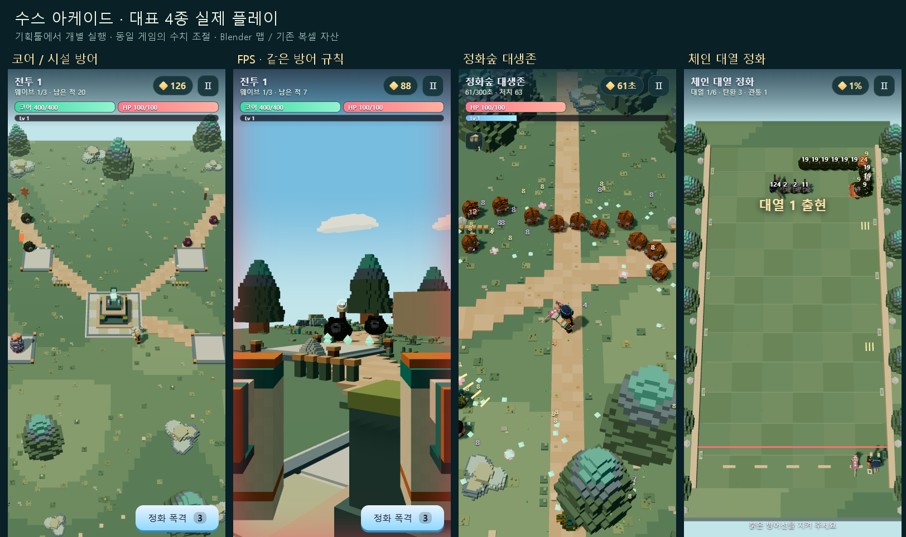
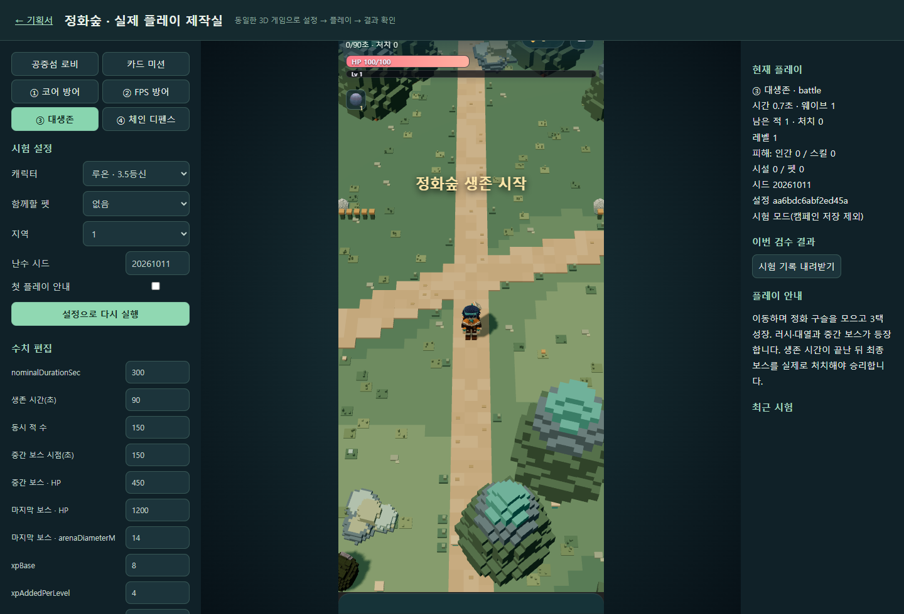
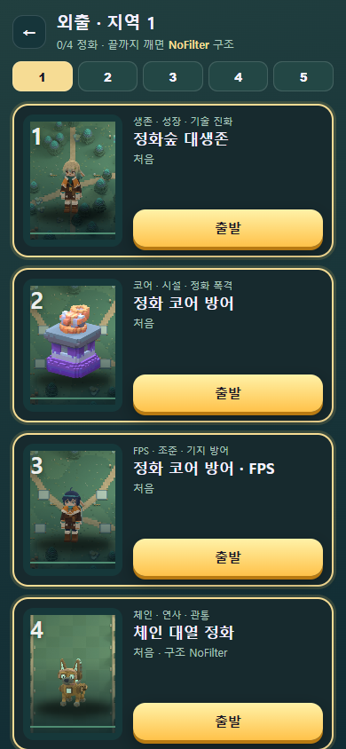
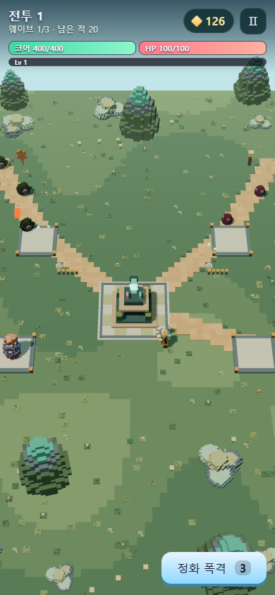
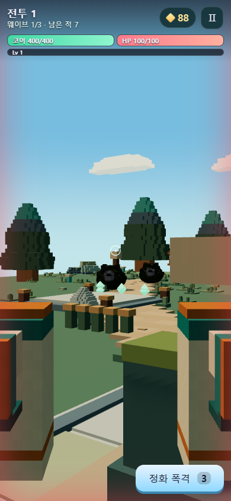
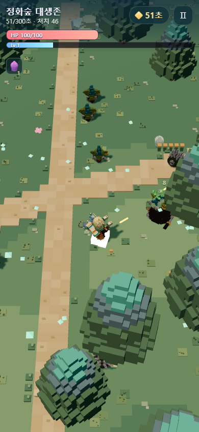
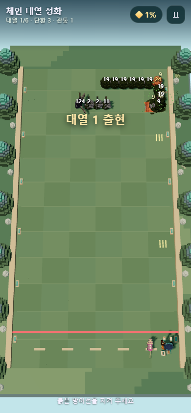
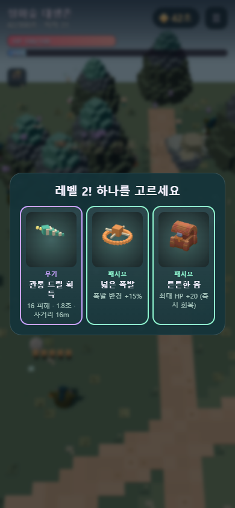
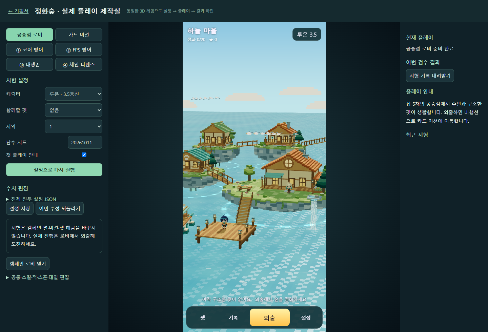
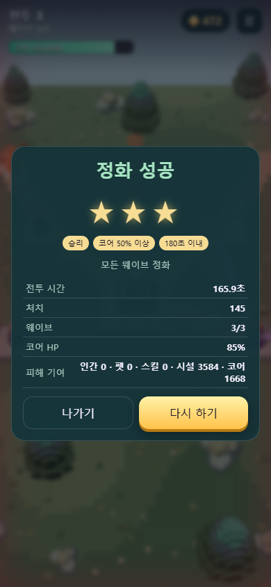

# 대표 4종 실제 플레이 완성 · 맵 개선 작업 보고

작성: Codex · 2026-10-11 16:05 KST
프로젝트: C:\soos-arcade

## 요청과 완료 범위

기획툴에서 로비·카드·대표4게임을 각각 실제 3D로 실행하고 수치를 조절하도록 연결했다. 기존 루온/리아·5펫·49복셀 몬스터와 시설/숲/마을 리소스를 활용했다. p02/p03/p04 미구현 안내를 실제 플레이로 교체했다. 소리와 배포 빌드는 이번 요청에서 제외됐다.

- p01: 3웨이브/보스·시설4종·성장·폭격·시설만 모드.
- p02: 같은 p01 전투의 FPS·두 터치 조작·쌍권총·시야 표적·후방 위협.
- p03: 자유 이동·떼/러시·XP/3택·추가 기술/4진화·중간/마지막 보스·실제 전리품.
- p04: 6체인 편대·개별HP·관통/탄수/연발·보급·보조 무기·경계 실패.
- 공중섬 로비와 20미션·해금/구조/저장/귀환 연결.
- 59아이콘/초상+20미션 카드 그림. 원본 무기/폭탄/시설/캐릭터/펫의 Blender 렌더를 재사용하고, 드릴/참격/유도탄/장판/진화 등 39카드를 실제 공격 형태의 블록 그림으로 추가 보정했다.
- 몬스터 지원/회복/잠복/공중/수중/방패/돌격/원거리/펫 구속 등의 실제 행동 연결.

## 맵과 추가 품질 보정

Blender로 방어/대생존/체인 3맵 × 오염/정화 2상태를 제작했다. 실제 길·광장·건설 칸·연못·캠프·나무/바위/등불/정화 크리스털과 같은 내비 장애물 자료를 사용한다. 1차 제작 후 바닥 색·겹친 길·숲 볼륨·소품 배치·선형 색상·카메라/조명을 다시 보정했고, 추가로 풀/돌/꽃·길 가장자리·광장/시설 받침·체인 보드 격자와 숲 그림자를 보강했다. 체인 카메라를 넓혀 숲 테두리가 보이게 하고 반환 분기 전에 태양 위치를 갱신하도록 고쳤다. FPS에는 로비의 복셀 하늘을 재사용했다.

최종 검수에서 시계가 매 프레임 초기화되는 정지 문제, FPS 이동 방향/총 경계 상자, 드론 탄의 발사 원점, 리아 초상 얼굴 숨김, 카드 배경 합성, 시험 메뉴 귀환/캠페인 잠금 혼동을 고쳤다. 150마리 밀집 장면은 인스턴스+LOD로 약220만 삼각형에서 725,600개로 줄였다.

## 실행

[기획툴 실제 플레이](http://localhost:4174/planner/#play) · [제작실 전체 화면](http://localhost:4174/planner/play.html) · [캠페인 로비](http://localhost:5190/arcade-lobby.html)

서버 재실행: `tools/start-arcade-complete.ps1 -OpenBrowser`.

## 검수

| 프로필 | 결과 | 시간 | 별 | 처치 | 펫 피해 |
|---|---|---|---|---|---|
| p01 | win | 136.57초 | 3★ | 145 | 87.2 |
| p02 | win | 133.52초 | 3★ | 145 | 110.0 |
| p03 | win | 309.38초 | 3★ | 853 | 550.0 |
| p04 | win | 94.75초 | 3★ | 204 | 0.0 |

위 표는 제어된 봇/고정 틱 검사의 기록이다. 실제 키보드/터치 조작도 별도로 확인했다. 각 모드의 자연스러운 실패 조건과 결과 화면, 다시 하기 버튼을 확인했다. 첫 지역 캠페인 4종 승리 후 정상 저장/다음 카드 해금/NoFilter 구조를 확인했고 시험은 캠페인 저장을 바꾸지 않는다.

- 모든 대표의 이동·일시정지·실패·재시작, 20스냅샷/그림 로딩.
- FPS 동시 터치 이동+시선과 체인 좌우 터치 이동.
- 23공격의 실제 피해, 4진화 교체, 화상·XP 보존·시험 격리.
- 회복3회 제한/보스 제외·지원·잠복·수중/공중·펫 구속 해제·앞/뒤 방패·3발 부채꼴.
- 기획툴에서 생존90초 설정 반영, 지역3 코어HP500/인간HP120/초기포인트250/4건설 칸 확인, 임시 코어 피해7 저장의 최소 차이값과 타 미션 보존 확인(검수 뒤 원래 값 복원), 음수HP 저장400 거절.
- strict TypeScript 통과. 검수에서 확인한 페이지의 JS 오류/404 없음.

- 최종 59아이콘 브라우저 로딩/384×384 크기·3택 카드 실제 표시 확인. 기술 39종의 의미가 구분되는 그림을 다시 렌더링했고 art-verification-final.json에 근거를 저장했다.

## 지역별 후속 밸런스 판단

20미션+시설 전용5판은 모두 정상 종료했고, 같은 제어 봇의 결과는 18승·7패다. 첫 지역4종과 시설 전용은 모두 승리했다. 뒤 지역 대생존과 일부 최종 방어에서 실패했으므로 전 지역 사람의 승률을 측정했다고 주장하지 않는다. 초기 보급과 일반 중장갑 HP를 보정했으며, 지역별 시작값과 실제 결과를 기획툴에서 보고 추가 조정할 수 있다.

최종 보스 생성 실패 재시도·최종 actor의 실제 사망 요구, 지역 수치 표시/보존, 미션별 최소 저장값도 추가 검수했다. 상세 JSON은 campaign-final/campaign-flow-final/planner-region-final에 있다.

## 화면

## 파일과 인수인계

- 상세 구조·편집/재생성·검수·인수인계 프롬프트: [구현 인수인계](../implementation/20261011_대표4종_실제플레이_구현인수인계_Codex.md)
- 실행 코드: src/arcadeComplete/ · 활성 표: assets/arcade/config-codex/
- 맵: assets/arcade/maps/CODEX_FOREST/ · 아트: assets/arcade/art/
- Blender 원본/생성 스크립트: art-source/arcade/CODEX_COMPLETE/
- 검수 스크립트: tools/arcade-complete-tests/
- 캡처/검수JSON/Blender 로그/파일SHA256 목록: docs/reports/assets/20261011_ArcadeComplete_Codex/

기존 src/arcade와 원본 캐릭터/펫 자산을 보존했다. 활성 HTML과 기획툴 연결 파일은 새 실행본을 사용하도록 수정했다. 다른 프로젝트·CodexPack·그룩 루틴·커밋/푸시는 수행하지 않았다.

## 측정 범위

PC 브라우저 검수와 제어된 플레이 결과다. 휴대폰 실기기 FPS/발열, 사람의 반복 플레이를 통한 20미션 전 지역 밸런스 통계, 첨부 영상과의 정량적 품질 비교는 측정하지 않았다. 이를 완료된 측정으로 표시하지 않는다. 이후 조정은 현재 제작실에서 실제 게임을 실행하면서 할 수 있다.
