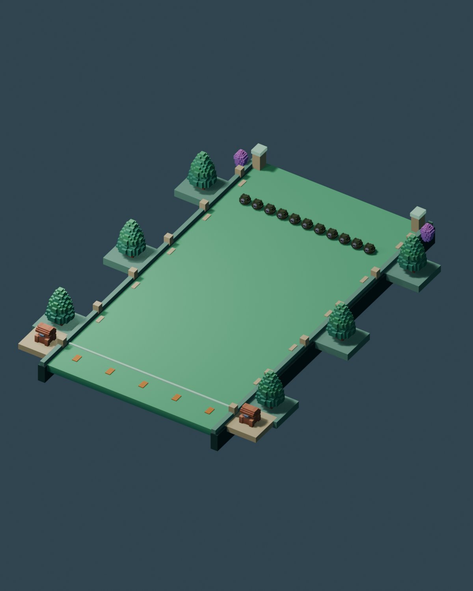
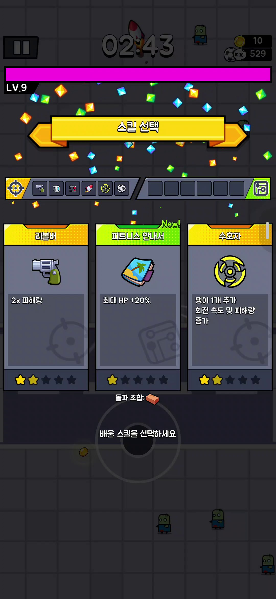

# 작업 보고서 — 대표 4종 제작기획과 영상 분석

작성: Codex · 2026-10-11T10:10:50+09:00

## 한 줄

수스 아케이드를 대표4프로필/공통3규칙으로 정리하고, 첨부3영상·PRISM47표·실제3D자산에 근거한 제작 명세·초기 데이터·Blender 준비 보드·AI 인수인계를 완성했다.

## 결과 위치

- [제작기획서](../plans/20261011_3D제작명세_v2_대표4종_Codex/00_제작기획서_Codex.md)
- [AI 전달 프롬프트](../plans/20261011_3D제작명세_v2_대표4종_Codex/06_제작AI_인수인계프롬프트_Codex.md)
- [검수 결과](../plans/20261011_3D제작명세_v2_대표4종_Codex/data/validation.json)
- [Blender 원본/GLB 안내](../plans/20261011_3D제작명세_v2_대표4종_Codex/13_Blender준비자산_검수_Codex.md)
- [전체 ZIP](../plans/20261011_3D제작명세_v2_대표4종_Codex.zip)

## 바꾼 파일

docs/plans/20261011_3D제작명세_v2_대표4종_Codex/의 문서15개·data22JSON·캡처·PRISM참조표·prepared/authoring/legacy 자료, 기존 Codex v1의 README/00 보관 안내, assets/arcade/preparation/CHAIN01 생성파일, art-source/arcade/CHAIN01 원본/스크립트, 이 보고서, BOARD Codex행.

planner/data.json·package.json·vite.config.ts·Claude PRISM 분석 파일은 생성 전후 해시가 같았다. 원본 배우/펫/몬스터/맵·기존 runtime 코드에는 쓰지 않았다. 커밋/푸시 없음.

## 핵심 변경

1. p01 후더덕형 / p02 같은 규칙 FPS / p03 탕탕·뱀서형 / p04 Cell형. 전투·성장·원소·스폰·결과 서비스1개, 정책3계열.
2. 슬롯·7패시브후보/4소유·진화4종·발사 패턴·XP·시설/범위포·연쇄/관통/공전·체인마디·승패·저장·기획툴 브리지·UI UX·로비생활·성능·M0~M6 검수 계약.
3. PRISM25스킬은 구조/패턴만 대응. 수스 기본/기존7종+추가12패턴+진화4+체인3 = 데이터27항목. 원본 수치와 수스 초기값을 구분했다.
4. Cell125.97초/탕탕279.17초/후더덕203.63초를 실제 캡처로 분석했다. 원작 성공/분열/전체길이가 영상에 없는 경우 단정하지 않았다.
5. 구 g03무리·g06굴착·g10러너는 초기 제외. g07길목/g08보스/g09칠은 흡수, g02방/g04호위는 후속. 기존10종 문서/자산은 보관. 5지역×4카드20미션은 초기 제안.
6. CHAIN01: 기존3D타일/나무/수정/상자 재사용, 12×24m, GLB713,880bytes, 환경24,264삼각형·55메시. Blend/생성스크립트/layout/통계/렌더2개 함께 보존.

## 검수

사용자 정의 구조/참조/예산/링크/GLB 검사 39개 통과. 지역20미션·49종ID·진화참조·25스킬대응·카드슬롯·기본탄40DPS·대열HP합·급습예산 포함·FPS규칙상속·파일해시·링크67개·GLB바닥Y0/XZ12×24·preview 제외를 확인했다. ZIP은 CRC 검사를 한다.

완전한 JSON Schema 검증기와 신규게임 플레이 검수는 수행하지 않았다. 수치는 플레이 검증 전 초기값이다. 생성된 환경은 준비 자산이며 실제 휴대전화 FPS/탄 판정/AI/승패 완료가 아니다.

## 스크린샷

## 다음 작업

제작 AI가 전달 프롬프트대로 M0→p01 완주→로비 연결→p03/FPS/Cell→20카드/모바일을 구현한다. 사용자 최신 지시에 따라 완료 시점부터2시간 뒤 Claude 구현을 이 명세/기준해시/실제 실행과 비교하는 일회 검토를 예약한다. 그룩 루틴은 재개하지 않는다.

## 막힌 질문

없음. 자동 승인 검토가 문서 삭제 후 재작성 시도를 거절하여, 문서를 삭제하지 않고 부분 갱신 방식으로 완료했다. 일반 게임 구현·모바일 플레이 검증은 다음 제작 단계다.

## 예약 검토 등록

자동화 claude 등록 완료: 2026-10-11 12:12 KST, 일회 검토. 완료 후 약2시간 뒤 Claude의 명세 이해/구현을 기준 패키지와 실제 실행으로 확인하고 검토 보고서를 남긴다. 종료된 그룩 루틴은 재개하지 않는다.
